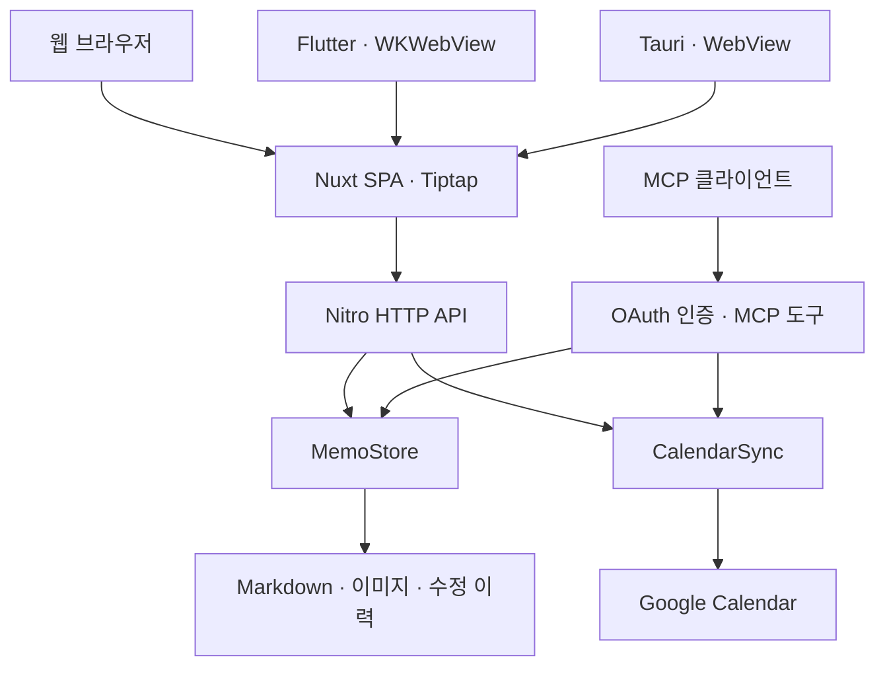

# personal-memo

마크다운 파일로 메모를 저장하는 단일 사용자용 메모 앱입니다. Nuxt 웹, Flutter 모바일 앱, Tauri 데스크톱 앱으로 같은 메모와 할 일을 관리합니다. 별도 데이터베이스 없이 파일시스템에 데이터를 보관합니다.

개인적으로 사용하는 앱의 소스 코드를 공개한 저장소입니다. 직접 호스팅하거나 용도에 맞게 수정해서 사용할 수 있습니다.

## 체험 사이트

**[memo-test.jun-devlog.win](https://memo-test.jun-devlog.win)**에서 웹 버전을 사용해 볼 수 있습니다. 로그인 비밀번호는 `memo-demo`입니다.

운영과 분리된 stage 환경에 견본 메모·할 일·태그를 넣어 두었습니다. 방문자가 같은 계정과 데이터를 공유하므로 내용을 수정하거나 삭제하면 다른 방문자에게도 반영됩니다. 개인 정보나 실제 업무 자료는 입력하지 마세요. Google Calendar 연동은 꺼져 있습니다.

## 버그 제보와 기능 제안

**PR은 원칙적으로 받지 않습니다. 버그 제보와 기능 제안은 [Issues](https://github.com/Junjak-Personal/personal-memo/issues)에 작성해 주세요.**

이 저장소는 실제 사용하는 개인 서버의 배포 소스입니다. `main`에 PR을 머지하거나 커밋을 push하면 검증을 거쳐 개인 서버에 자동 배포됩니다. 개인 사용 환경과 운영에 맞춰 변경을 직접 검토하고 반영하므로, PR을 보내기 전에 이슈에서 먼저 이야기해 주세요. 사전에 협의한 경우에만 PR을 검토합니다.

버그를 제보할 때는 재현 순서, 기대한 동작과 실제 동작, 브라우저 또는 iOS 환경을 함께 적어 주세요. 비밀번호, 서비스 계정 키, 개인 메모 내용은 포함하지 말아 주세요.

## 주요 기능

- 폴더와 태그로 메모 정리, 제목·본문 검색
- Tiptap 기반 편집기: 표, 이미지, 코드 블록, 목차와 섹션 접기
- 메모 간 내부 링크와 백링크, 재사용할 수 있는 메모 템플릿
- 자동 저장, 수정 이력 조회·복원, 휴지통
- 할 일의 완료 여부·중요도·날짜 관리와 캘린더 보기
- 날짜가 있는 미완료 할 일을 Google Calendar 전용 캘린더로 단방향 동기화
- 선택한 메모·폴더의 외부 공개와 공개 링크 탐색, OAuth 승인 기반 MCP 연결
- iPhone 웹뷰 앱의 네이티브 편집 툴바와 공유 확장
- Tauri 데스크톱 앱에서 기존 웹 편집기와 인증·저장 기능 재사용

## 기술 구성

| 영역 | 구성 |
| --- | --- |
| 웹 | Nuxt 4, Vue 3, TypeScript, SPA |
| UI | Nuxt UI 4, Tailwind CSS 4 |
| 편집기 | Tiptap 3 |
| 서버 | Nuxt의 Nitro 서버와 파일 기반 API 라우트 |
| 저장 | Markdown + YAML frontmatter, 로컬 파일시스템 |
| 인증 | nuxt-auth-utils, 단일 사용자 비밀번호의 scrypt 해시 |
| 외부 연동 | Google Calendar API, MCP SDK |
| iOS | Flutter, WKWebView, Swift 공유 확장 |
| 데스크톱 | Tauri 2, Rust, 운영체제 WebView |
| 검증·배포 | Vitest, GitHub Actions, Docker |

## 크로스플랫폼 구성

웹 앱을 기반으로 Flutter 모바일 앱과 Tauri 데스크톱 앱을 구현했습니다. 각 플랫폼에서 편집기와 저장 로직을 따로 만들지 않고, 같은 Nuxt 화면과 서버 API를 사용합니다. 플랫폼별 앱은 창 관리, 키보드와 툴바, 공유 기능 등 운영체제와 맞닿는 부분을 맡습니다.

| 플랫폼 | 디렉터리 | 구현 방식 |
| --- | --- | --- |
| 웹 | [`app/`](app/) | 브라우저에서 Nuxt/Vue SPA 실행 |
| 모바일 | [`app-ios/`](app-ios/) | Flutter 앱의 WKWebView로 웹을 열고 네이티브 툴바·공유 확장 연결. 현재 구현 대상은 iPhone |
| 데스크톱 | [`app-desktop/`](app-desktop/) | Tauri WebView로 같은 웹을 열고 창·메뉴·외부 링크 처리. 현재 macOS 앱 빌드 구성 제공 |

데스크톱의 Windows/Linux 분기는 코드에 있지만 해당 OS의 패키징·실행은 미검증입니다. 데스크톱 빌드와 로컬 개발 방법은 [`app-desktop/README.md`](app-desktop/README.md)에 있습니다.

## 프로젝트 구조

```text
personal-memo/
├── app/                       # Nuxt 웹 앱
│   ├── components/            # 공통 UI 컴포넌트
│   ├── composables/           # 메모·탐색·저장 등 화면 상태와 동작
│   ├── pages/                 # 메모, 할 일, 캘린더, 태그, 연결 관리 화면
│   │   └── */_modules/        # 해당 화면 전용 컴포넌트와 로직
│   └── utils/                 # 편집기와 화면 유틸리티
├── server/
│   ├── api/                   # HTTP API
│   ├── memo/                  # 메모 파일·폴더·이력·템플릿 저장 로직
│   ├── calendar/              # Google Calendar 동기화
│   ├── mcp/                   # MCP 도구와 업로드 처리
│   ├── oauth/                 # MCP 클라이언트와 권한 관리
│   ├── routes/                # MCP·OAuth 엔드포인트
│   ├── middleware/            # 인증과 공개 경로 처리
│   └── plugins/               # 주기적 동기화와 휴지통 정리
├── shared/                    # 웹·서버가 함께 쓰는 타입과 유틸리티
├── app-ios/                   # Flutter 앱과 iOS 네이티브 코드
├── app-desktop/               # Tauri 앱, Rust 창·탐색 정책, 연결 안내 화면
├── scripts/                   # 비밀번호 해시 생성, 배포, 스모크 검사
├── ops/                       # 개인 서버 백업·복원 스크립트와 안내
├── tests/                     # 편집기 표 브라우저 회귀 검사
├── _docs/                     # 설계와 구현 기록
├── .github/workflows/         # PR 검증과 main 자동 배포
└── data/                      # 로컬 실행 데이터, Git 추적 제외
```

웹 화면은 `server/api/`를 통해 데이터를 읽고 저장합니다. 메모 저장 로직은 `server/memo/`에, 웹과 서버가 공유하는 데이터 형태와 규칙은 `shared/`에 둡니다. 단위 테스트는 주로 대상 파일 옆의 `*.test.ts`에 있습니다.

메모는 `${NUXT_DATA_DIR}/memos/` 아래의 `.md` 파일에 저장합니다. 제목·날짜·태그 등의 메타데이터는 YAML frontmatter에, 본문은 Markdown에 보관합니다. 폴더별 첨부 이미지는 `assets/`, 휴지통·수정 이력·템플릿은 별도 숨김 폴더로 관리합니다.

## 기술적 설계

### 요청과 저장 흐름



화면은 SPA로 실행하고, 인증과 파일 접근은 Nitro 서버에서 처리합니다. 웹 API와 MCP 도구는 같은 `MemoStore`를 사용하므로 파일명, 메타데이터, 충돌 검사, 휴지통 규칙을 공유합니다. `shared/types/`와 `shared/utils/`에는 화면과 서버 양쪽이 사용하는 데이터 형태와 규칙을 둡니다.

### 파일 저장과 외부 편집기 호환

- **파일 식별:** 앱에서 만든 메모는 ULID를 갖습니다. 제목이나 폴더가 바뀌어도 ID는 유지되므로 내부 링크가 파일 경로에 종속되지 않습니다.
- **YAML 보존:** frontmatter를 단순 객체로 변환해 다시 쓰지 않고 `yaml`의 `Document`로 다룹니다. 앱이 모르는 키와 주석을 보존하고, 태그 등은 값이 바뀐 경우에만 갱신합니다. 읽을 수 없는 frontmatter는 앱에서 덮어쓰지 않습니다.
- **변경 감지:** 별도 파일 감시 프로세스 대신 요청 시 `stat`으로 재스캔합니다. 수정 시각과 크기가 바뀐 파일만 다시 읽어 외부 편집기의 변경을 반영합니다.
- **파일 교체:** 같은 디렉터리의 임시 파일에 쓰고 `fsync`한 뒤 `rename`으로 교체합니다. 최종 경로에 본문을 직접 덮어쓰는 도중 일부만 저장되는 상황을 피합니다.
- **경로 검사:** 입력 경로를 저장 루트 기준으로 해석하고 실제 경로도 확인합니다. `..`와 절대경로, 루트 밖을 가리키는 심볼릭 링크를 통한 접근을 거부합니다.

구현: [`file.ts`](server/memo/file.ts), [`scan.ts`](server/memo/scan.ts), [`fsx.ts`](server/memo/fsx.ts), [`paths.ts`](server/memo/paths.ts).

### 자동 저장과 충돌 처리

본문 자동 저장은 입력이 멈춘 뒤 기본 1초 후에 실행합니다. 요청이 진행되는 동안 추가 입력이 생기면 기존 요청이 끝난 뒤 다시 저장하고, 서버 응답을 받은 뒤에만 「저장됨」으로 표시합니다.

클라이언트는 메모를 읽을 때 받은 `version`을 저장 요청의 `baseVersion`으로 보냅니다. 서버가 현재 파일에서 계산한 버전과 다르면 HTTP `409`를 반환하고, 사용자가 다시 불러오기 또는 덮어쓰기를 선택할 때까지 자동 저장을 멈춥니다. 버전은 SHA-256 기반이며, 별도 액션으로 바꾸는 `done`·`priority`·`public` 필드는 계산에서 제외합니다. 본문 저장은 이 세 필드의 현재 값을 유지합니다.

저장 요청 직전에는 전송할 내용을 `localStorage` 초안으로 보관하고, 성공 응답 뒤에 제거합니다. 네트워크 오류로 실패하면 연결 복구 시 재전송을 시도합니다. 충돌이 난 초안은 자동으로 덮어쓰지 않습니다. 이 보관은 브라우저 저장소를 사용할 수 있을 때의 복구 수단이며, 서버 저장을 대신하지 않습니다.

구현: [`useMemoAutosave.ts`](app/pages/m/_modules/useMemoAutosave.ts), [`memo-drafts.ts`](app/utils/memo-drafts.ts), [`store.ts`](server/memo/store.ts).

### 편집기와 Markdown 왕복

Tiptap 문서와 저장용 Markdown을 오가며 편집합니다. 밑줄은 `<u>…</u>`, 이미지는 상대경로로 저장하고, 화면에 표시할 때만 인증된 이미지 API 주소로 변환합니다. 표는 GFM 표와 지원하는 HTML 병합 셀을 처리합니다.

외부 도구로 작성한 문서를 편집기에 넣었다가 다시 직렬화했을 때 의미 있는 형식 차이가 생기면 자동 저장을 멈추고 확인을 받습니다. 표 공백이나 빈 줄처럼 표시상 의미가 같은 차이는 비교 과정에서 정규화합니다. 편집 화면과 외부 공개 화면은 같은 본문 확장 구성을 공유합니다.

구현: [`editor-extensions.ts`](app/utils/editor-extensions.ts), [`editor-table.ts`](app/utils/editor-table.ts), [`canonical-table-html.ts`](app/utils/canonical-table-html.ts).

### 수정 이력과 복원

수정 저장 전에 이전 내용을 `.history/`에 보관합니다. 연속 저장은 5분 간격으로 묶고, 메모마다 최근 30일 이내의 최대 50개 버전을 유지합니다. 지원하는 로컬 이미지와 원본도 이력에 복사하므로 현재 폴더의 이미지와 독립적으로 복원할 수 있습니다.

복원도 현재 편집기가 알고 있는 `baseVersion`으로 충돌을 확인합니다. 복원 직전 상태를 먼저 보관한 뒤 제목·본문·날짜·태그를 복원하고, 현재 메모의 ID·생성일·할 일 상태·공개 여부는 유지합니다.

구현: [`history.ts`](server/memo/history.ts), [`store.ts`](server/memo/store.ts).

### 인증과 메모 공개

일반 웹 API는 `nuxt-auth-utils`의 쿠키 세션으로 인증합니다. 로그인 비밀번호는 scrypt 해시로 검증하며, 연속 5회 실패하면 15분 동안 로그인을 잠급니다. 잠금 카운터는 단일 사용자 앱의 프로세스 메모리에 있으므로 서버 재시작 시 초기화됩니다.

외부 공개는 메모의 `public: true` 또는 공개된 상위 폴더의 설정을 기준으로 허용합니다. 폴더 공개 설정은 `.public.json`에 보관하고 하위 메모의 frontmatter를 덮어쓰지 않습니다. 공개 화면은 공개 항목만 모은 탐색 목록을 사용하며, 공개 이미지 경로는 그 메모의 본문이 실제로 참조하는 이미지만 제공합니다. 수정 이력과 비공개 메모의 백링크는 공개 응답에 포함하지 않습니다.

구현: [`auth.ts`](server/middleware/auth.ts), [`login-guard.ts`](server/utils/login-guard.ts), [`store.ts`](server/memo/store.ts).

### Google Calendar 동기화

동기화 기준은 메모 파일입니다. `date`가 있고 `done: false`인 할 일만 종일 일정으로 내보내며, Google Calendar에서 수정한 내용을 메모로 가져오지는 않습니다.

동기화는 서버 시작 뒤, 5분 주기, 관련 메모 변경 뒤에 실행합니다. 앱에서 관리하는 일정의 메모 ID와 현재 메모 스냅숏을 비교해 생성·수정·삭제 계획을 먼저 계산한 뒤 API를 호출합니다. 본문만 바뀌고 캘린더에 표시할 제목·날짜가 같으면 불필요한 대조를 줄입니다. 실행 중 추가 요청은 다음 대조 한 번으로 합칩니다.

삭제 계획에는 보호 조건이 있습니다. 메모 파일이 전부 없거나 삭제 대상이 기준치를 넘으면 주인 없는 일정의 삭제를 보류하고 화면에 알립니다. 실패한 작업은 다음 대조에서 다시 시도합니다.

구현: [`sync.ts`](server/calendar/sync.ts), [`reconcile.ts`](server/calendar/reconcile.ts), [`calendar-sync.ts`](server/plugins/calendar-sync.ts).

### MCP와 OAuth

`/mcp`는 Streamable HTTP의 POST 요청과 JSON 응답을 사용하며, 프로토콜 세션과 서버 발신 SSE 스트림은 두지 않습니다. 요청마다 Bearer 토큰을 검사한 뒤 MCP 서버를 생성합니다. 인증되지 않은 요청에는 HTTP `401`과 OAuth 자원 메타데이터 위치를 반환합니다.

연결 승인은 로그인한 소유자가 수행하며, 인가 코드 교환에 PKCE의 `S256`을 사용합니다. 갱신 토큰은 사용 시 교체하고, 이미 사용된 갱신 토큰이 다시 들어오면 해당 연결을 폐기합니다. MCP 수정 도구도 읽을 때 받은 버전을 사용하므로 웹과 같은 충돌 검사를 거칩니다. 삭제 도구는 휴지통 이동만 제공하고 영구 삭제는 제공하지 않습니다.

구현: [`mcp.ts`](server/routes/mcp.ts), [`tools.ts`](server/mcp/tools.ts), [`grants.ts`](server/oauth/grants.ts).

### 모바일·데스크톱과 웹의 역할 분리

Flutter 앱은 키보드 위 네이티브 툴바를 제공하고, 실제 서식 명령은 JavaScript 브리지를 통해 웹의 Tiptap에서 실행합니다. 웹은 포커스와 현재 서식 상태를 Flutter에 알립니다. 공유 확장은 받은 내용을 App Group 보관함에 넣고, 웹에서 서버 저장을 완료했다고 응답한 항목만 제거합니다.

Tauri 앱은 번들에 연결 안내 화면을 담고, 메모 화면은 설정된 서버의 WebView로 엽니다. 로그인은 기존 쿠키 세션을 사용하며 브라우저 쿠키나 비밀번호를 Rust로 복사하지 않습니다. 같은 출처의 탐색은 앱 안에서 처리하고, 외부 HTTP(S)·메일 링크는 기본 브라우저로 보냅니다. 원격 페이지에는 Tauri IPC 권한을 부여하지 않으며, 파일 접근과 셸 실행 기능도 열지 않습니다.

구현: [`useNativeBridge.ts`](app/pages/m/_modules/useNativeBridge.ts), [`memo-inbox.client.ts`](app/plugins/memo-inbox.client.ts), [`main.rs`](app-desktop/src-tauri/src/main.rs), [`policy.rs`](app-desktop/src-tauri/src/policy.rs).

### 실행 범위

`MemoStore`의 쓰기 큐와 인덱스는 서버 프로세스 안에서 공유합니다. 현재 구조는 단일 사용자·단일 서버 프로세스를 기준으로 하며, 여러 서버 인스턴스 사이의 분산 잠금이나 실시간 공동 편집을 제공하지 않습니다. 모바일·데스크톱 앱도 같은 서버에 접속하는 방식이므로 별도 로컬 메모 저장소와 양방향 오프라인 동기화를 구현하지 않습니다.

## 로컬 실행

Node.js 24와 pnpm이 필요합니다. pnpm 버전은 [`package.json`](package.json)의 `packageManager`를 따릅니다. 현재 지정된 버전은 `12.6.0`입니다.

```sh
git clone https://github.com/Junjak-Personal/personal-memo.git
cd personal-memo
pnpm install --frozen-lockfile
cp .env.example .env.local
```

`.env.local`에 아래 두 값을 설정합니다.

1. `openssl rand -base64 32`로 생성한 값을 `NUXT_SESSION_PASSWORD`에 넣습니다.
2. 로그인에 사용할 비밀번호의 scrypt 해시를 생성해 `NUXT_ADMIN_PASSWORD_HASH`에 넣습니다.

다음 명령은 Bash 또는 Zsh에서 비밀번호를 화면에 표시하지 않고 입력받아 해시를 출력합니다. 첫 줄을 실행한 뒤 비밀번호를 입력하고 Enter를 누르세요.

```sh
read -rs memo_password
printf '%s' "$memo_password" | node scripts/hash-password.mjs
unset memo_password
```

환경변수를 설정한 뒤 개발 서버를 실행합니다.

```sh
pnpm dev
```

`http://localhost:4700`에 접속해 앞에서 정한 비밀번호로 로그인합니다. `pnpm dev`는 `.env.local`을 읽습니다.

### 환경변수

전체 키와 설명은 [`.env.example`](.env.example)에 있습니다. 실제 값은 `.env.local` 또는 `.env.prd`에 두며, 두 파일 모두 Git과 Docker 빌드에서 제외합니다.

| 변수 | 용도 |
| --- | --- |
| `NUXT_SESSION_PASSWORD` | 필수. 32자 이상의 세션 쿠키 서명 키 |
| `NUXT_ADMIN_PASSWORD_HASH` | 필수. 로그인 비밀번호의 scrypt 해시 |
| `NUXT_DATA_DIR` | 데이터 저장 경로. 기본값 `./data` |
| `NUXT_SITE_URL` | 외부에서 접속할 앱 주소. 캘린더 링크와 OAuth 등에 사용 |
| `NUXT_GOOGLE_CALENDAR_ID` | 선택. 동기화 대상 전용 캘린더 ID |
| `NUXT_GOOGLE_SERVICE_ACCOUNT` | 선택. 서비스 계정 키 JSON을 Base64로 인코딩한 값 |
| `NUXT_GOOGLE_SERVICE_ACCOUNT_FILE` | 선택. 서비스 계정 키 파일 경로 |
| `NUXT_MCP_CLIENT_ORIGINS` | MCP 클라이언트 신원 문서를 허용할 출처. 기본값은 `https://claude.ai,https://chatgpt.com` |
| `E2E_PASSWORD` | 개발용 자동 시험의 로그인 비밀번호. 운영 환경에서는 사용하지 않음 |

Google Calendar 연동은 캘린더 ID와 서비스 계정 키를 함께 설정해야 켜집니다. 키는 Base64 값 또는 파일 경로 중 한 가지 방식으로 전달합니다. 사용하지 않으면 관련 값을 비워 둡니다. 연동 시에는 서비스 계정에 전용 캘린더의 수정 권한을 부여해야 합니다.

**개발과 운영에서 같은 캘린더를 사용하지 마세요.** 동기화는 해당 서버의 메모 상태를 기준으로 앱이 관리하는 일정을 정리하므로, 개발 서버가 운영 일정을 삭제할 수 있습니다. 개발용 데이터 폴더와 캘린더를 따로 사용합니다.

### 확인 명령

```sh
pnpm typecheck
pnpm test
pnpm build
```

## 배포와 운영

현재 저장소의 GitHub Actions는 다음 순서로 동작합니다.

```text
main 대상 PR → GitHub 호스팅 러너에서 타입 검사·테스트·빌드
main에 머지/push → 동일 검증 통과 → 개인 서버의 N100 러너에서 Docker 빌드·배포 → 헬스체크
```

운영 데이터는 컨테이너 외부 볼륨에 보관하고, 비밀값은 GitHub Actions의 secrets 또는 실행 환경에서 주입합니다. 수동 배포용 [`scripts/deploy.sh`](scripts/deploy.sh)와 [`ops/`](ops/README.md)는 관리자의 개인 서버 환경에 맞춰져 있습니다. 직접 호스팅할 때는 서버 경로, 도메인, 러너와 시크릿 설정을 본인 환경에 맞게 구성해야 합니다.

iOS 앱은 `app-ios/`의 서버 접속 주소와 앱 식별자·서명을 본인 환경에 맞춰 설정해야 합니다. 데스크톱 정식 빌드도 현재 개인 서버 주소를 사용하므로, 직접 호스팅할 때는 `app-desktop/`의 서버 주소 정책과 식별자를 함께 변경해야 합니다. 웹 앱만 실행하는 경우 Flutter나 Rust·Tauri 도구는 필요하지 않습니다.

### 체험용 stage 운영

[`scripts/deploy-stage.sh`](scripts/deploy-stage.sh)는 현재 운영 컨테이너의 이미지 revision이 checkout과 같은지 확인한 뒤, 해당 이미지 ID를 stage에 사용합니다. 별도 소스를 빌드하거나 운영 컨테이너를 교체하지 않습니다. stage는 자동 배포 대상이 아니며 관리자가 명시적으로 갱신합니다.

| 항목 | stage 설정 |
| --- | --- |
| 공개 주소 | `https://memo-test.jun-devlog.win` |
| 호스트 포트 → 컨테이너 포트 | `127.0.0.1:4701` → `4700` |
| 컨테이너 / 이미지 태그 | `personal-memo-stage` / `personal-memo:stage` |
| 서버 데이터 경로 | `~/apps/personal-memo-stage/data` |
| 인증 | 공개 비밀번호 `memo-demo`, 운영과 다른 세션 키·쿠키 이름 |
| 외부 캘린더 | 비활성 |

```sh
# 관리자용: 개인 서버의 검증된 이미지를 stage에 배치하고 견본 데이터 추가
./scripts/deploy-stage.sh junserver

# 빠진 견본만 다시 추가. 기존 메모를 덮어쓰거나 삭제하지 않음
node scripts/stage-demo/seed.mjs --url https://memo-test.jun-devlog.win

# stage 시드의 대상 제한과 기존 데이터 보존 회귀 검사 (CI에서도 실행)
node --test scripts/stage-demo/seed.test.mjs
```

시드 스크립트는 지정된 테스트 도메인 또는 로컬 4701 주소만 허용합니다. 데이터는 재배포해도 유지하며 주기적으로 초기화하지 않습니다.

## 라이선스

[MIT License](LICENSE)
