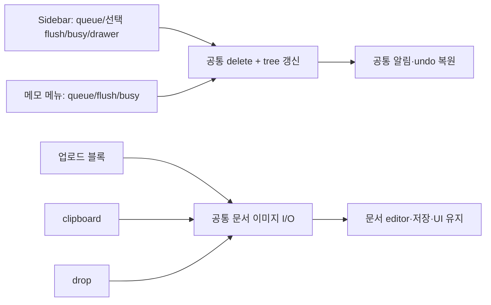

# 동작을 보존하는 메모 책임 분리·공통화

- status: processing
- verdict: VERIFY_BLOCKED (구현·자동 검사 통과, 개발 화면의 업로드/undo 확인은 브라우저 연결 중단으로 미완료)
- baseRef: 976ba17669c18c374707f5a35956cc9669db3ebe
- startedAt: 2026-10-20T14:05:00Z
- branch: codex/refactor-shared-editor
- 최초 범위: 구현·검증·기록. 이후 사용자 「일단 배포하고, 앱설치」에 따라 웹 배포와 기존 운영 iPhone 앱 업데이트 설치를 진행한다. 서버 계약/파일 형식/의존성/인프라/인증 변경 없음.
- 기존 app-ios 수정·신규 파일 5개와 미추적 `mobile-menu-navigation.test 2.ts`, `node_modules 2/`를 보존한다. 파일 해시를 _workspace에 기록했다.

## 조사와 결정

1. 사이드바798줄/메모문서708줄/서버저장소704줄을 포함해 UI·에디터·state/API 책임 경계를 살폈다. 기준 Vitest는 37 files / 370 tests PASS다.
2. 두 곳에서 실제 동일한 휴지통 이동/undo transport·tree 반영·알림을 공통화한다. 화면별 queue/flush/busy와 drawer/nav 순서는 남긴다. TrashList는 병렬 refresh/복원 성공 정책이 달라 합치지 않는다.
3. MemoDocument의 세 진입점(업로드 블록/clipboard/drop)이 공유하는 이미지 I/O를 useMemoImages로 분리한다. 문서의 savedTitle/baseline/draft/autosave/route guard/startup/drag/표 schema·CSS는 유지한다. 원본 보기 modal 상태와 안전 URL 검사는 문서에 남긴다.
4. 표는 memoExtensions→memoTableKit·table-layout·app.config CSS를 이미 공유한다. 범용 Editor/아이콘 버튼 wrapper는 ref/slot/Teleport/터치 영역 위험에 비해 중복 감소가 작아 보류한다. 초기화/복원/tree는 이미 session/gate에 분리돼 있고, generic async catch는 도메인 실패 정책이 달라 추가하지 않는다. 서버 Store는 파일 배타 큐와 도메인 메서드가 응집돼 있어 이번 분리 이득이 작다.

## 계약·파일 소유권

- state agent: 신규 useMemoTrashActions.ts/test, AppSidebar.vue, MemoActions.vue. moveToTrash(id)는 DELETE→tree refresh→실제 trashPath를 반환하고 오류를 전파한다. notifyMoved(trashPath)는 기존 toast/undo 복원·이동·오류 처리를 담당한다. Sidebar의 refresh→닫기→toast 및 MemoActions의 refresh→toast→홈 이동 순서를 보존한다.
- editor agent: 신규 useMemoImages.ts/test. getEditor/currentMemoId getter를 주입하고 uploadImage/insertImageFiles/onPaste를 반환한다. ID는 업로드 직전, editor는 삽입 시작 때 캡처한다. 원본 보관 header·경고·동일 src 재탐색·순차 업로드·드롭 위치를 보존한다.
- parent: MemoDocument 연결·기준선·통합 검증·문서. 한 파일 한 편집자 원칙.
- 별도 read-only 통합/데이터 검토: 원본 이미지 URL·실제 trashPath·저장/화면 전환 순서 보존 확인.

## 수용 검사

- 삭제/복원 endpoint·ID encoding·실제 trashPath·실패/갱신/알림/nav 순서 회귀 테스트.
- 이미지 display/original form, originalSkipped 안내, ID getter 시점, 파일 필터/순차 삽입/drop 위치, foreign src/header/중복·재탐색 회귀 테스트.
- 기존 복원·tree·startup·자동저장·표·모바일 drag 전체 회귀 테스트 유지.
- 최종 통합 전체 Vitest·Nuxt typecheck/build, 기존 격리 dotenv/합성 데이터/캘린더 OFF 개발 화면 스모크 1회. 운영 data 열람 없음. native 파일 해시 보존 확인.

## 구현 결과

- `useMemoTrashActions.ts` 34줄로 Sidebar/MemoActions의 DELETE·tree 갱신·실제 trashPath·undo 복원/이동/오류 처리를 공유했다. 화면별 queue/flush/busy·drawer 닫기·notify·홈 이동 순서를 보존했다. Sidebar는 798→785줄, MemoActions는 112→97줄(두 화면 합계28줄 감소). TrashList는 정책 차이를 유지했다.
- `useMemoImages.ts` 86줄로 업로드 블록/clipboard/drop의 이미지 I/O를 분리했다. MemoDocument는708→638줄. 이것은 단일 화면의 책임 분리이며 중복 제거로 계산하지 않는다. ID 전송 직전 조회, captured editor, 원본 보관 헤더/경고, 파일 순차 처리·드롭 위치·await 뒤 src 재탐색을 보존했다.
- `useMemoTrashActions.test.ts`7개, `useMemoImages.test.ts`11개 회귀 검사를 추가했다. 신규 패키지/서버 계약/파일 형식 변경 없음. 세 Vue template은 baseRef와 byte 동일하다.
- 자동저장·충돌·route guard·표 schema/CSS·모바일 drag·세션 tree/복원/startup 코드는 변경하지 않았다. native 작업과 기존 미추적 파일을 보존했고 HEAD는976ba17로 커밋/push/배포/앱 설치 없음.

## 완료한 검사

- 기준: `node node_modules/vitest/vitest.mjs run` →37 files/370 tests PASS.
- 최종 전체: 같은 명령 →**39 files/388 tests PASS**, exit0(1.62초). 이미지11·휴지통7 추가. 기존 파일 저장/Markdown·HTML 병합 표/모바일 블록/복원/tree/startup 검사도 포함한다.
- `node node_modules/nuxt/bin/nuxt.mjs typecheck` →exit0.
- `node node_modules/nuxt/bin/nuxt.mjs build --dotenv _workspace/e2e/2026-10-20-mobile-block-scroll/smoke.env` →exit0(9.76초).
- `git diff --check` PASS. 기존 native·사용자 파일6개 해시 동일 확인.
- 독립 통합/데이터 검토에서 새로운 차단 회귀 없음. API·세션·저장 형식과 삭제/저장/알림/nav 순서, 원본 URL scheme guard, 원본 header 보관/이미지 ID 시점을 확인했다.
- `_workspace/e2e/2026-10-20-refactor/{baseline-tests,tests-final,typecheck-final,build-final}.log`, `preserved-files-before.json`, `interrupted-ui-status.json`에 근거를 남겼다.

## 개발 화면 중단과 정확한 잔여

- localhost:4721, 기존 합성 데이터·캘린더 OFF에서 첫 스플래시→마지막 메모/editor 표시, 새 합성 메모 생성·제목 입력·이미지 업로드 블록 열기까지 확인했다.
- 합성 PNG 파일 선택 흐름 중 도구가 종료됐다. 선택/승인/업로드 완료 결과를 받지 못했으므로 **결과 불명**이며 같은 업로드를 반복하지 않았다. 사용자 재개 승인 후 Mac inventory 연결은 읽었으나 AgentChrome의 선택/승인 창 읽기는 `Transport closed`로 다시 실패했다. 별도 보안 권한 확대/승인 우회 없음.
- 안전한 결과 확인: dotenv의 NUXT_DATA_DIR가 `_workspace/e2e` 아래임을 먼저 확인하고 합성 메모만 읽었다. 「리팩토링 검증 · 합성 메모」 파일은 생성돼 있고 저장 본문의 이미지 참조는0개다. 이것만으로 이미지 전송 여부/고아 asset 유무/승인 결과를 단정하지 않는다.
- **미완료:** (1) 이미지 선택/승인 결과 확인 후 기존 합성 메모의 업로드 완료·표시·저장, (2) 같은 합성 메모의 메모 메뉴/Sidebar 휴지통 이동→undo 복원 UI, (3) 표/모바일 블록 UI 스모크. 실제 iPhone도 미검증.
- **구체적 재개 절차:** CUA 브라우저 transport를 복구하고 기존 파일 선택/승인 창 및 합성 메모 상태부터 읽는다. 미실행을 확인한 경우에만 PNG 업로드를1회 시도한다. 이후 해당 합성 메모만 삭제/undo 확인한다. 이미 통과한 자동 검사에는 소스가 바뀌지 않는 한 재실행이 필요 없다. 승인 결과는 추정하지 않는다.
- 재연결 뒤 기존 dev 실행 세션은 executor key가 바뀌어 종료 응답을 확인할 수 없었다. 별도 읽기 전용 `lsof -nP -iTCP:4721 -sTCP:LISTEN`에는 listener가 없음을 확인했다. 재개 시 같은 격리 dotenv로 dev 서버를 다시 시작해야 한다. 기존 프로세스나 앱을 임의 종료하지 않았다.
- `harness-team` Phase4의 “VERIFY_BLOCKED … keep a lifecycle plan in active/processing/”에 따라 완료 archive/최종 QA 항목을 생성하지 않았다. 앱 실패가 입증된 것이 아니라 UI 드라이버/승인 결과 확인이 막힌 상태다.

## 화면 재검증 재시도·사용자 중단 (2026-10-21 KST)

- 사용자 「화면 검증 다시해봐」에 따라 같은 localhost 합성 환경을 재개했다. 기존 메모 본문은 빈 상태였으며 파일 선택 창/이미지 노드는 남아 있지 않았다.
- 준비 화면→기존 합성 메모 복원→업로드 블록 열기→filechooser 이벤트 수신까지 성공했다. `fileChooserOpened:true, multiple:false`를 받았다.
- 실패 위치는 `retryChooser.setFiles([합성 PNG], {timeoutMs:10000})`다. 이 호출은 정상 반환하지 않고 node_repl kernel이 SIG9로 종료됐다. 파일 전송/삽입/저장 완료는 확인되지 않았다. timeout 옵션은 사용했지만 호출이 장시간 종료되지 않았으며 이는 앱의 실패로 판정하지 않는다.
- 별도 브라우저 세션에서 일반 DOM/메뉴 동작이 가능함은 확인했다. 마지막 성공은 메모 메뉴 열기뿐이고 「휴지통으로」 선택은 실행하지 않았다. 이후 사용자 요청으로 **새 브라우저 호출·승인 재시도·브라우저 변경·권한/설정 변경을 모두 중단**했다.
- 사용자 보고: 허용을 눌렀는데 승인 요청이 반복됨. 도구 관측: 승인 완료/거절의 구조화 응답은 받지 못함. Mac connected/authorized는 읽혔지만 이 상태만으로 개별 브라우저 요청의 승인을 입증하지 않는다.
- `Transport closed`는 앞선 AgentChrome 상태 읽기에서 관측됐고 setFiles의 kernel 종료와 같은 연결 문제의 가능성은 있으나 **인과관계·근본 원인은 미확인**이다. 사용자 승인 거절 또는 앱 업로드 버그라고 단정할 근거가 없다.
- 현 도구 목록에는 브라우저 승인 카드 취소 전용 API가 없다. 실행 중인 브라우저 호출은 반환/오류로 끝났으며, UI에 남은 승인 카드의 취소 여부는 새 브라우저 호출 없이 확인할 수 없다. reset/보안 설정 변경으로 우회하지 않는다.
- 자동 388개/타입/빌드 결과는 유효하고 소스 변경 없음. 이미지 전송 결과는 불명, 삭제/undo·표/drag 추가 UI는 미실행 상태를 유지한다. 개발 서버는 소유 실행 세션에 정상 종료를 요청했다.

## 남긴 후보와 이유

- 표/아이콘·범용 Editor wrapper: 이미 공유되는 schema/CSS/UButton을 다시 감싸는 이득이 작고 ref/slot/Teleport/touch 영역 위험이 크다.
- 초기화/복원/목록·generic error wrapper: 이미 session-tree/startup-gate로 나뉘어 있고 실패 정책이 달라 합치지 않았다.
- 자동저장·draft/충돌 및 서버 Store 전면 분리: 파일 배타 큐와 문서 저장 상태의 결합을 바꾸는 위험이 크다.
- 동일 날짜 formatter: 두 곳에 있지만 효과가 작아 이번 범위에서 보류했다.
- 예약 이미지 처리/업로드의 unmount 취소: 기존에도 captured editor를 계속 참조할 수 있다. 이번 추출이 새로 만든 문제는 아니며 취소/보관 정책을 결정하는 별도 후속 작업으로 남겼다.

## 배포·네이티브 설치 진행 (2026-10-21 KST)

- 사용자 「일단 배포하고, 앱설치」 승인으로 미완료 UI 범위를 유지한 채 배포한다. 브라우저 호출·승인 재시도 중단은 계속 지킨다. 운영 메모 데이터 열람/수정 없이 기존 main 배포 workflow와 공개 health/build 정보만 확인한다.
- 기존 네이티브 스플래시 작업도 운영 앱 업데이트에 포함한다. Flutter 의존성은 `pub get --offline --enforce-lockfile`로 기존 잠금 버전을 준비했고 lockfile 변경은 없다.
- `flutter analyze --no-pub` PASS. `flutter test --no-pub`는 실패 후 재시도 테스트가 타이머를 남기는 것을 발견해 준비 완료 응답까지 검증하도록 보완한 뒤 **5 tests PASS**. 앱 동작 로직 변경은 없다.
- 설치 대상은 기존 페어링된 iPhone 15 Pro, 운영 번들 `win.jundevlog.memo`와 공유 확장/App Group을 유지한다. 기존 앱 삭제·데이터 초기화·보안 설정 변경은 하지 않는다.
- 미추적 `mobile-menu-navigation.test 2.ts`, `node_modules 2/`는 커밋에서 제외한다. 화면 검증 미완료이므로 processing/VERIFY_BLOCKED 기록은 유지한다.
