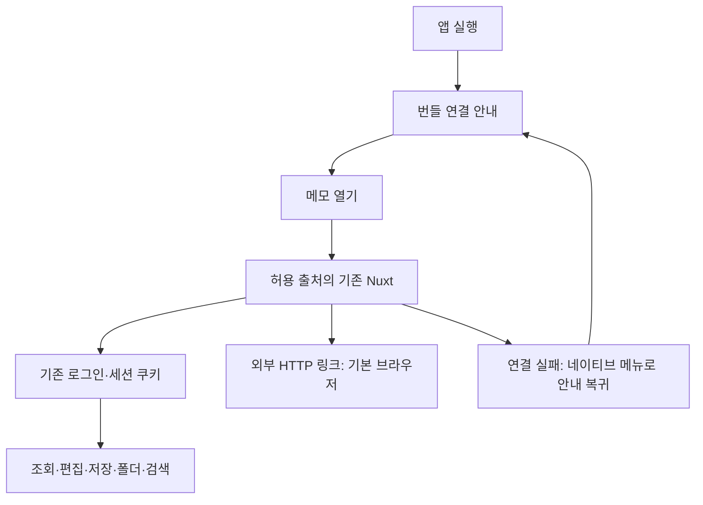

# Tauri 데스크톱 MVP

- status: processing
- verdict: 핵심 검증 통과 (2026-11-04 macOS 설치·세션 재실행 확인). 추가 native 경계 QA는 미검증 — 아래 후속 기록 참고
- issue: https://github.com/Junjak-Personal/personal-memo/issues/10
- baseRef: b8b1334fecc10928296905efb4e1c10f702c1ec1
- startedAt: 2026-11-01T15:24:00Z
- branch: feat/tauri-desktop-10
- 범위: macOS 로컬 구현·패키징·실행·재실행·합성 데이터 검증. 원격 push/PR/병합/배포/설치/공증 제외.

## 구성 결정

기존 Nuxt는 SPA지만 Nitro 인증 세션·같은 출처 API·이미지·Markdown 파일 저장소를 사용한다. app-ios와 같은 원격 웹뷰가 기존 웹과 정확히 같은 편집기를 재사용한다. 프런트엔드를 번들하면 CORS·쿠키·경로·API 주소 분리와 웹/앱 버전 조합을 새로 관리해야 하므로 MVP에서는 채택하지 않는다. 번들하는 것은 연결 안내 HTML뿐이다.

- app-desktop/만 독립 Node/Rust 잠금 파일과 Tauri 빌드를 가진다. 웹·iOS·모바일 사이드바는 변경하지 않는다.
- 정식 빌드는 고정 HTTPS 출처만 내부 탐색. debug/local-test는 명시한 localhost/127.0.0.1/[::1] 개발 서버만 허용하고 별도 앱 식별자를 사용한다.
- 원격 IPC 권한 0, fs/shell/http 플러그인 없음, Tauri 전역 API 없음. 서버는 브라우저와 같은 세션 인증을 수행한다.
- 외부 http/https/mailto 링크는 기본 브라우저로 보내고 그 밖의 스킴·다운로드·웹 권한 요청을 거절한다. 새 창의 같은 출처 링크는 기존 창으로 연다.
- 세션·초안은 앱 전용 WebView 저장소에 보존한다. 비밀번호/토큰을 앱 코드나 자체 파일에 복사하지 않는다. 오프라인 동기화는 하지 않는다.

## 수용 검사

- Rust fmt/clippy/test, 웹 기존 typecheck/test/build. 웹 린터는 설정 없음.
- native macOS 패키지와 합성 데이터 로컬 서버. 로그인 중단·반복 클릭·취소·뒤로가기·재실행/세션 유지.
- Markdown·표·이미지·링크를 편집/저장 뒤 서버 파일 및 재조회와 대조. 기존 웹 회귀도 같은 합성 데이터로 확인.
- 다른 OS는 미검증으로 기록. 실제 계정/운영 데이터/설치/배포는 실행하지 않음.

## 최종 변경과 보안 검토

- `app-desktop/`: 독립 CLI/Rust 잠금 파일, Tauri 설정·아이콘, Rust 탐색 정책·기본 브라우저 연결·메뉴, 로컬 연결 안내, 합성 서버 실행 도구·사용 설명.
- `server/middleware/auth.ts`: 세션·개인 API 응답 `Cache-Control: no-store`. 이미지 라우트가 설정하는 기존 private immutable 정책은 보존.
- `server/middleware/auth-session.ts`: 기존 `DELETE /api/_auth/session` 계약(true)과 clear 훅을 유지하면서 설정된 세션 이름의 루트 쿠키를 명시적으로 만료. h3의 원래 clear는 값만 비우는 세션 쿠키를 설정했다.
- `server/middleware/auth*.test.ts`: API/일반 화면·인증 성공/거절·기존 훅 오류·설정된 쿠키 이름/삭제 순서 회귀 9개.
- 초기화 스크립트: 기존 WebKit 캐시도 재사용하지 않도록 허용 출처 API fetch에만 no-store. 다른 출처·정적 자원·Request·쿠키/본문/headers/credentials는 유지. 네이티브 명령이나 인증 정보를 추가하지 않는다.
- 원격 capability는 0. 파일시스템·프로세스·네트워크 플러그인·updater·키체인 권한 없음. Dialog는 Rust 메뉴에서만 사용. 외부 URL은 파싱/스킴 확인 후 `open` crate에 전달한다.
- `app-ios/`와 웹 편집기·저장소·모바일 사이드바는 변경하지 않았다. 기존 작업 폴더의 미추적 파일은 이 복제에 옮기거나 삭제하지 않았다.

## 실행한 검사 (2026-11-01 UTC / 11-02 KST)

| 검사 | 결과 | 근거 |
|---|---|---|
| `pnpm typecheck` | 통과 | `_workspace/desktop-10/typecheck.log` |
| `pnpm test` | 57파일 601개 통과 (기준 55파일 592개) | `test.log` |
| `pnpm build` | 통과 | `build.log` |
| Rust fmt/clippy(-D warnings)/test | 통과, 정책 테스트 3개 | `desktop-check.log` |
| Node bootstrap 테스트 | 4개 통과 | `bootstrap-test.log` |
| 정식 macOS .app 빌드 | 통과, ad-hoc 서명, 공증 없음 | `desktop-production-build.log` |
| localhost용 macOS .app 빌드 | 통과 | `desktop-build.log` |
| 합성 데이터 실제 파일/API/이미지 대조 | 통과 | `data-check.json` |
| 실제 HTTP 세션 캐시 경계 | 통과 | `session-check.json` |
| 실제 DELETE 세션 응답/Max-Age=0/기존 true 응답 | 통과 | `logout-cookie-check.json` |
| 웹 린트 | 설정 없음 (미실행) | 기존 package/profile |
| 네이티브 최종 세션 보완 후 재실행 | 차단 | Mac 잠금. 아래 구분 참고 |
| Windows/Linux·iOS 실행·운영 계정/데이터 | 미실행 | 요청 범위/환경 경계 |

로그 경로는 모두 이 worktree의 `_workspace/desktop-10/` 아래다. 자격증명 값은 문서에 쓰지 않는다.

## 실제 UI에서 확인한 것과 한계

macOS 27.0.1 Apple Silicon에서 빌드 폴더의 `Memo Local Test.app`을 직접 실행했다. Applications에 설치하지 않았다. 컴퓨터 사용의 AX/화면으로 다음 결과를 관찰했다.

- 기존 비밀번호 로그인 뒤 합성 폴더 목록 표시. 앱 종료→재실행→메모 열기 뒤 로그인 세션 유지.
- 「데스크톱」 검색 실행→합성 메모 1건→문서 열기. Markdown 제목/굵게/기울임/코드·2×2 표·이미지·링크 렌더링.
- 본문 끝에 합성 문장 추가→저장됨→기존 웹에서 재조회. 실제 Markdown 파일에 추가 문장과 표/서식/링크/이미지 참조 보존, 이미지 바이트 원본 일치.
- 폴더 이동 취소 후 원래 폴더 유지. 다시 이동해 「이동 대상」으로 변경, 실제 파일 경로/API 응답에서도 확인. ⌘[ 뒤로가기는 홈으로 이동.
- 연결 열기 더블 클릭 뒤 창 1개. 연결 복귀 ⌘⇧L 확인창과 취소 버튼 확인, 취소 후 기존 할 일 화면 유지.
- 네이티브 메뉴 클릭 일부는 도구/사용자 화면 변경과 겹쳐 확정 근거로 쓰지 않았다. 단축키를 통한 확인창·취소는 별도로 관찰했다.

**발견한 실패**: 로그아웃→미제출 비밀번호 입력→종료→재실행에서 인증된 화면이 다시 보였다. 별도 loopback 출처 프록시에 no-store를 넣었을 때 로그인 화면으로 돌아왔지만, 오래 사용한 localhost 출처는 재현이 남았다. 따라서 캐시만이 원인이라고 확정하지 않는다. h3가 쿠키를 비우기만 하는 사실을 확인하고 명시적 만료 보완을 추가했다. 최종 만료 응답은 HTTP로 확인했으나 이 보완 뒤 네이티브 재실행은 아직 검증하지 않았다.

**정확한 차단**: `Memo Local Test.app`에 ⌘Q를 보내는 도중 CUA가 `The Mac is locked and automatic unlock could not unlock it.`를 반환했다. 그 UI 동작은 실행되지 않았다. 이후 경로를 확인한 이번 테스트 앱 프로세스·Nuxt 서버·프록시는 SIGTERM으로 종료했다. 권한 거절을 우회하거나 Mac 잠금을 해제하지 않았다. 승인 대기/승인 거절은 없으며, 사람의 Mac 잠금 해제가 필요하다.

외부 링크 OS 브라우저 열기·네이티브 다운로드/권한 거절·서버 중단 후 복구는 정책/단위 테스트 또는 코드 검토만 확인했고 최종 실제 UI 검증은 남았다. 실제 계정·운영 서버는 접속/변경하지 않았다. 정식 원격 앱은 빌드만 했고 실행하지 않았다.

## 이어갈 순서

1. Mac 잠금 해제. 최종 수정의 핵심은 **로그아웃 후 인증이 복원되지 않는지**다. 이 결과 전에는 완료/이슈 닫기를 하지 않는다.
2. 기존 시험 세션을 재현하려면 `_workspace/desktop-10/.env.test`를 그대로 사용해 서버를 다시 띄운다. 이 파일 값을 출력하지 않는다. `start-server.mjs`를 다시 돌리면 세션 키가 바뀌어 이전 쿠키 문제가 가려지므로 사용하지 않는다.
   `node node_modules/nuxt/bin/nuxt.mjs dev --dotenv _workspace/desktop-10/.env.test --port 4710 --host 127.0.0.1`
3. 최종 localhost용 앱으로 로그인→성공 재실행 유지→로그아웃→미제출 입력→종료/재실행→빈 로그인 화면을 확인. 서버와 실제 보호 API도 비인증인지 확인. 실패하면 native cookie persistence와 서버 삭제 경계를 추가 진단한다.
4. 외부 링크·다운로드 거절·서버 중단/복구·연속 클릭을 실제 앱에서 마무리한다. Mac locked 상태에서는 UI 도구를 반복 호출하지 않는다.
5. `app-desktop/README.md`의 명령과 아래 인계 기록으로 이어간다. 원격 push/PR/병합/배포/공증/설치는 별도 지시 전까지 하지 않는다.

## 작업 상태

- 미커밋, `HEAD=b8b1334fecc10928296905efb4e1c10f702c1ec1`, branch `feat/tauri-desktop-10`.
- push/PR/병합/운영 배포/공증 인증서/실제 사용자 데이터 변경/앱 설치 없음.
- 계획은 processing에 유지. 자동 검사 통과를 최종 네이티브 세션 QA 통과로 바꾸지 않는다.

## 2026-11-04 후속 — 사용자 승인에 따른 정식 빌드 설치·main 반영

- 사용자 「메인에 반영」「prd 빌드로 설치」 승인으로 정식 빌드를 `/Applications/Memo.app`에 설치했다. `win.jundevlog.memo.desktop` / 0.1.0, 고정 주소 `https://memo.jun-devlog.win/`. 서명 및 빌드/설치 실행 파일 동일성 확인, 실제 실행·개인 서버 연결 확인. 실제 메모 수정 없음.
- 현재 소스로 웹601·Rust3·초기화4·타입검사·웹 빌드·fmt·clippy·정식/로컬 macOS 패키징 통과. 근거는 `_workspace/desktop-10/prd-install-20261104/` 및 `desktop-{check,prd}-current*.log`.
- 기존 `.env.test`와 시험 세션 키를 유지한 로컬 앱에서 재실행 후 로그인 유지, 로그아웃→미제출 시험 입력→종료(기존 PID 종료 확인)→재실행→빈 로그인 화면·인증 화면 미복원 확인. `native-restart-result.json`에 핵심 결과 기록. 이전 Mac 잠금에 따른 세션 QA 차단은 해소됐다.
- 현재 판정: 자동 검사·macOS 설치·핵심 세션 검증 통과. 외부 링크 OS 브라우저 열기·다운로드/권한 거절·서버 중단 복구의 추가 native QA, Windows/Linux 실행은 미검증. 사용자가 추가 테스트를 멈추고 main 반영을 마무리하도록 지시해 더 넓은 QA는 진행하지 않는다.
- 정식 앱은 개인 vault 접속용이며 App Store 출시 계획은 없다. 설치는 로컬 ad-hoc 서명이며 공증 배포나 스토어 출시가 아니다.
