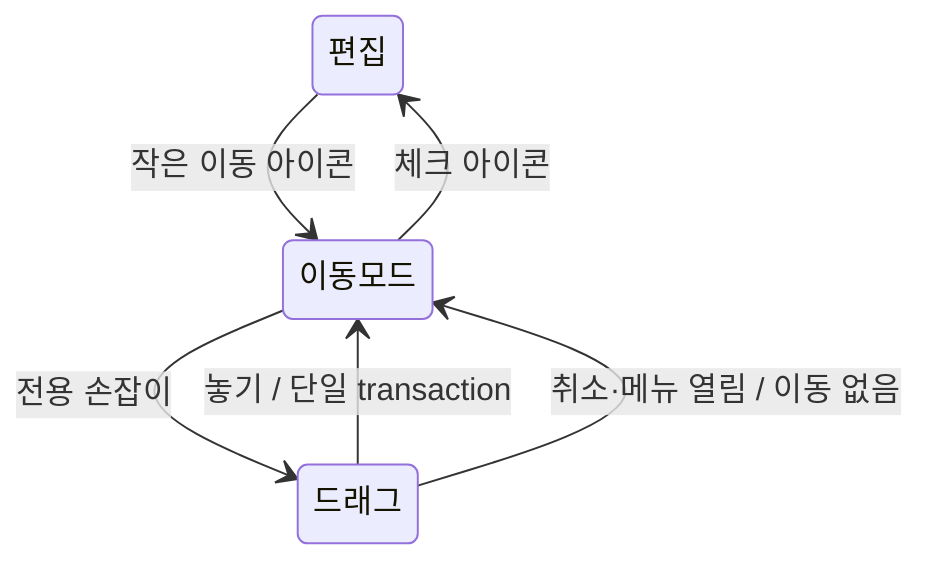

# 모바일 블록 이동 UI 후속 수정

- status: complete
- baseRef: a1537c10b0706b5260c57f5f2a8c11c1cbd78dde
- startedAt: 2026-10-19T14:03:42Z
- branch: codex/mobile-block-move-refinement
- 범위: 모달 제거·작은 배경 없는 아이콘·체크 완료·레이어 수정과 10/20 왼쪽 +/손잡이·여백 축소. 최초 구현·검증 뒤 사용자 「이대로 배포 ㄱ」로 배포 승인됨.
- 보존: 미추적 `app/utils/mobile-menu-navigation.test 2.ts`, `node_modules 2/`는 사용자/외부 작업으로 간주하고 수정·삭제하지 않는다.

## 이미지와 원인

- Library 원본 두 장을 이 Mac의 `_workspace/mobile-feedback/IMG_3740.png`, `IMG_3741.png`로 공식 materialization helper를 통해 전송, 파일 존재·읽기 및 픽셀 확인 완료. 다른 환경 경로 사용 안 함.
- 첫 이미지: body로 Teleport한 z-40 손잡이가 모달 위에 남아 있다. 두 번째: 테두리·배경·24px 아이콘과 완료 텍스트 버튼이 과도하게 크다.

## 수용 기준

1. 손잡이 탭에서 이동 모달을 열지 않는다. 기존 전용 손잡이 드래그·삽입선·가장자리 스크롤로 이동.
2. 44px 터치 영역은 유지하고 모든 이동 버튼은 배경·테두리 없는 작은 아이콘, 완료는 체크 아이콘. 기존 ⋯ 메뉴와 같은 UButton neutral/ghost, 헤더 20px·본문 sm 16px·공통 상태 토큰 재사용. 진입/완료 텍스트와 화면 안내 제거, 접근성 이름 유지. 왼쪽 +/드래그, 작은 여백 추가 요청 반영.
3. 손잡이는 메모 패널 내부 stacking context로 제한. 사이드바가 열리면 숨기고 진행 중 drag 취소. 다른 팝업보다 앞에 떠오르지 않는다.
4. 키보드 위/아래 방향키 대안 유지, 마우스/터치 탭·본문 텍스트 선택·스크롤과 충돌 없음. 저장·undo·취소 정리 보존.
5. 관련 테스트·Nuxt 타입검사·빌드 및 가능한 합성 데이터 개발 화면 확인. 실제 메모·운영 데이터 미접촉.

## 검증

### VERIFY_PASS — 자동 검증

| 검사 | 실제 명령 | 결과 / 증거 |
|---|---|---|
| 관련 회귀 | `node node_modules/vitest/vitest.mjs run app/pages/m/_modules/editor/MobileBlockMove.test.ts` | 1파일 16개 PASS, `_workspace/mobile-refinement-focused.log` |
| 통합 테스트 | `node node_modules/vitest/vitest.mjs run` | 31파일 304개 PASS, exit 0, `_workspace/mobile-refinement-tests.log` |
| Nuxt 타입검사 | `node node_modules/nuxt/bin/nuxt.mjs typecheck` | exit 0, `_workspace/mobile-refinement-typecheck.log` |
| 프로덕션 빌드 | `node node_modules/nuxt/bin/nuxt.mjs build` | exit 0, 10.4초, `_workspace/mobile-refinement-build.log`; 기존 큰 청크 경고 |
| 공백 검사 | `git diff --check` | PASS |

- 기준 a1537c1의 선행 검증은 31파일 297개 PASS. 기존 9개 SFC setup 테스트를 현재 tap 동작에 맞게 갱신하고 새 7개를 추가했다. 실제 템플릿을 컴파일해 이동 모달/화면 안내 없음·아이콘 전용 UButton neutral/ghost·44px class·체크 icon·접근성 이름·방향키 연결을 검증한다. 왼쪽 44px 버튼 영역 비중첩·원래 양쪽 padding 보존·+ 추가 전 편집 복원 및 위치 전달·drag/sidebar 뒤 추가 방지·sm 아이콘과 간격 토큰도 확인한다.
- 드래그·한 번 undo·임계값·pointercancel·문서 변경·숨김·unmount 정리 테스트 보존. 키보드 이동 후 실제 목적 손잡이 focus, sidebar 열림 시 capture 취소/새 이동 방지, panel Teleport 대상·시각 뷰포트 clip을 추가 검증.
- 초기 focused 실행은 새 composable을 stub하지 않은 테스트 하네스의 ReferenceError를 보였다. 하네스에 실제 ref 기반 sidebar stub을 추가하고 현재 UI 요구에 맞는 테스트로 갱신한 뒤 위 명령 모두 통과했다. 제품 실행에서 발견된 오류로 주장하지 않는다.

### 최초 화면 확인 제한 — 잠금 해제로 해결

- 첨부 이미지 두 장은 현재 Mac에 실제 전송하고 파일 존재·읽기·픽셀을 확인했다. 원본의 z-index 문제와 큰 버튼은 이 이미지 및 코드로 확인했다.
- 수정 후 개발 화면 확인 시도: Chrome에서 합성 메모 `http://127.0.0.1:4719/m/01M59Z2CD00MBQYN0Z46YY08DK`를 새 탭으로 열려 했으나 첫 UI 동작에서 Mac 잠금으로 차단됐다. 도구는 자동 unlock 실패 및 수동 잠금 해제를 요구했다. **개발 UI 열기는 미실행**, 새 화면 육안·실제 pointer 드래그 검증은 미확인이다.
- 사용자가 잠금 해제 후 알려주도록 입력 요청을 남겼다. 새 잠금 해제 근거 없이 UI 동작 재시도하지 않았다. 서버는 기존 합성 dotenv/격리 NUXT_DATA_DIR로만 기동했으며 종료했다. 실제 메모·캘린더·운영 접촉 없음.
- CI/배포/앱 설치/커밋/push 없음. 최신 원격 main과 작업 기준 일치 확인 후 별도 branch에서만 수정했다.

### 2026-10-20 잠금 해제 후 개발 확인 / 추가 요청 반영

- 사용자 「잠금해제했음 ㄱ」로 기존 차단 조건이 해소되어 UI 열기를 1회 재시도, Chrome localhost 합성 메모 로드 성공. 이전 미실행 기록은 최초 시도 이력이며 현재는 화면 확인을 완료했다.
- 사용자 「데탑처럼 left에 +, 드래그」·「너무 크다/여백 조금 더 작게」·「+랑 드래그 사이 간격」 피드백을 같은 변경에 반영. 본문 오른쪽 손잡이 대신 왼쪽에 +와 drag 나란히, 각 44px. 처음 왼쪽 배치 padding 96px에서 72px로 24px 축소, 아이콘 20→16px, glyph를 안쪽으로 각각 8px 당겨 둘 사이 시각 간격 16px 축소. 화면/스크린샷으로 최신 정렬 확인.
- +는 mode를 닫고 편집/padding을 복원한 뒤 기존 PC suggestion handler에 블록 pos 전달. 실제 둘째 블록 + → 해당 블록 바로 아래 slash 블록 메뉴 표시 → 본문 선택 → 「추가한 검증 블록」 입력, 원래 셋째 블록 앞에 추가된 위치/편집/저장 보존 확인.
- 이동 중 날짜 popup은 손잡이를 정상적으로 덮으며, sidebar open은 손잡이 전부 숨김. 체크 아이콘·모드 진입에는 화면 텍스트/가이드가 없고 공통 ghost 상태·정렬을 확인했다. Console은 기존 Suspense/Canvas2D 경고, 새 앱 오류는 관찰하지 않았다.
- 네이티브 drag/scroll 도구는 Chrome 대상 좌표를 찾지 못하는 `windowNotFoundAtPosition` 오류로 포인터 동작이 시작되지 않았다. 창 Raise와 새 좌표 근거로 확인했으나 해결 안 되어 더 반복하지 않았다. **개발 Chrome의 실제 포인터 drag와 손가락 스크롤은 실행/검증되지 않음**. 실제 SFC pointer handler + PM doc/history 자동 회귀는 통과했다. iPhone 실기기도 미검증이다.
- 마지막 코드 검증 뒤 리뷰용 localhost:4719 개발 서버를 재시작하고 사용자가 보고 있던 합성 메모 탭은 유지했다. 운영 배포·커밋·push는 하지 않았다.

## 통합 검토 / 문서 정합성

- 손잡이 overlay를 body 전역 z-40에서 main panel의 isolate 안으로 옮겼다. 패널 내부 z-10 및 clip-path로 헤더/키보드 영역에서 잘리고 portal modal/slideover 아래에 놓이도록 했다. sidebar 열림 중 overlay를 숨기며 sync watch로 capture된 드래그를 취소한다.
- 버튼은 MemoActions의 UButton neutral/ghost를 재사용한다. 헤더는 기본 md(20px), 본문 +/drag는 PC 손잡이처럼 sm(16px), 기존 UI slot의 translate-x-2/-translate-x-2로 glyph 간격만 좁힌다. 별도 버튼 CSS/새 시각 컨테이너 없음. 공통 hover/pressed/focus/disabled 토큰 유지. drag 중 선택만 기존 primary 토큰으로 표시한다.
- 화면 텍스트 진입/완료/안내와 tap 메뉴를 제거했다. 이동 안내는 sr-only 및 aria-label로만 남기고 키보드 위아래 이동 후 이동한 블록 손잡이에 focus를 유지한다.
- 개인정보/데이터 검토: 새 저장소·네트워크·서버 계약·계정/권한/자격 증명 변경 없음. 첨부 이미지와 전송 메타는 gitignore된 workspace에만 보관한다. 사용자 미추적 두 경로와 원본 Mac checkout을 보존한다.
- SSOT·UI profile·profile index·선행 구현의 후속 링크를 갱신, processing 문서 complete 이동. 관련 링크와 lifecycle/status/index/SSOT 최신성 대조. 기존 에메랄드 구현 링크의 옛 active 경로는 별도 범위라 미수정이다.

## Deferred QA

### 2026-10-19-mobile-block-move-refinement-01
- Priority: P1
- Preconditions: 합성 데이터 개발 서버, iPhone WKWebView
- Actions: 작은 이동 아이콘 진입, 왼쪽 + 블록 추가·여러 종류 블록 전용 손잡이 drag/drop·가장자리 스크롤·취소·한 번 undo
- Expected: tap 모달 없음, 실제 위치와 삽입선 일치, 본문 스크롤·이동/undo 자동저장 보존
- Source: 사용자 모달 제거·기존 드래그 수용 기준, 자동 setup/core 검증의 실기기 잔여
- Status: pending
- Evidence: —

### 2026-10-19-mobile-block-move-refinement-02
- Priority: P1
- Preconditions: 합성 메모의 이동 모드, sidebar/날짜 popup/다른 modal을 열 수 있는 환경
- Actions: 손잡이 drag 중 sidebar 열기, 날짜 popup 및 modal 열기, 닫고 본문 스크롤·모드 완료
- Expected: 손잡이가 modal/sidebar/헤더/키보드 위로 넘지 않음, 숨김 중 이동 없음, 포인터/편집 잠금 고착 없음
- Source: 사용자 이미지 IMG_3740의 레이어 결함, panel isolation·clip 변경
- Status: pending
- Evidence: —

### 2026-10-19-mobile-block-move-refinement-03
- Priority: P2
- Preconditions: 393~400px 폰 화면, light/dark, keyboard/VoiceOver
- Actions: 이동·완료 아이콘을 옆 ⋯/cloud와 비교, 44px 영역 터치·방향키 이동·Escape 종료·평소 long press 텍스트 선택
- Expected: 헤더 공통 20px·본문 16px 아이콘과 상태 표현 일치, 왼쪽 +/drag 비중첩·작은 시각 간격, 체크/이동 텍스트·시각 가이드 없음, 접근성 이름/focus 유지, 일반 편집·스크롤 정상
- Source: 사용자 아이콘 UI 통일·설명 제거 추가 요청
- Status: pending
- Evidence: —

## 배포 승인 후 진행 (2026-10-20)

- 사용자 「이대로 배포 ㄱ」 승인에 따라 이 변경을 커밋하고 main에 push하여 기존 GitHub Actions 배포를 진행한다. 앞의 미배포·미커밋 기록은 구현 검증 당시 상태다.
- fetch 후 원격 main과 작업 기준 `a1537c10b0706b5260c57f5f2a8c11c1cbd78dde`가 일치한다. 최신 검증은 304개 테스트·Nuxt 타입검사·빌드 모두 통과했으며 이후 제품 코드 변경 없음.
- 기존 사용자 미추적 두 경로·원본 checkout·실제 메모 데이터는 보존하고 커밋에서 제외한다. 배포 비밀값·권한·네이티브 앱은 변경하지 않는다.
- CI 검증/운영 이미지 교체 결과 및 공개 health·제공 빌드를 확인해 최종 보고한다.
