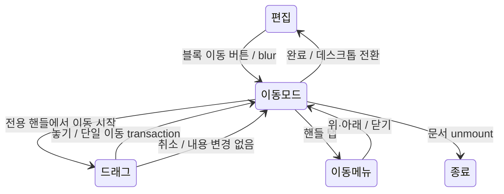

# 모바일 블록 이동 모드

- status: complete
- baseRef: 7f602c0685eafb66bd1e05b47b7eab9b46788d85
- startedAt: 2026-10-19T13:15:00Z
- branch: codex/editor-handle-hover
- pre-existing work: PC 핸들 8px hover 간격 수정(MemoDocument + drag-handle-options/test), 보존하고 함께 검증.
- 승인: 사용자가 블록 이동 모드 제안에 「ㅇㅇ 그렇게 가자」. 구현·테스트 범위, 새 배포 승인 없음.

## 설계와 수용 기준

1. 평소에는 기존 입력/본문 스크롤/길게 눌러 텍스트 선택을 유지한다.
2. 모바일 상단 「블록 이동」으로 명시 진입, 키보드 닫고 편집 일시 중지. 각 최상위 블록에 44px 전용 핸들 제공.
3. 핸들에서만 포인터 드래그, 삽입선과 가장자리 자동 스크롤, 탭 메뉴 위/아래 이동. 본문은 스크롤.
4. 목록·표·이미지 attrs와 marks를 보존하며 최상위 블록 단위로 이동. 한 이동 = 한 PM transaction/실행 취소. 이후 입력과 undo 그룹 분리.
5. 완료/라우트 이동/문서 변경/포인터 취소/데스크톱 전환에서 정리. 기존 자동저장·offline draft·충돌·이동 가드 보존.
6. 서버 계약/네이티브 브리지 계약/의존성 변경 없음. 합성 데이터 개발 확인만, 원본 메모/운영/배포 접촉 없음.

## 역할

- core: block-move.ts/test (최상위 나열·이동·선택·undo/기하 계산)
- UI: MobileBlockMove.vue + MemoDocument 연결·자동저장 회귀·문서 정합성

## 검증

### VERIFY_PASS

| 검사 | 명령 | 실제 결과 / 증거 |
|---|---|---|
| 통합 테스트 | `node node_modules/vitest/vitest.mjs run` | 31파일 297개 PASS, exit 0, `_workspace/mobile-tests.log` |
| Nuxt 타입검사 | `node node_modules/nuxt/bin/nuxt.mjs typecheck` | exit 0, `_workspace/mobile-typecheck.log` |
| 프로덕션 빌드 | `node node_modules/nuxt/bin/nuxt.mjs build` | exit 0, 10.5초, `_workspace/mobile-build.log`; 기존 큰 청크 경고 |
| 공백 검사 | `git diff --check` | PASS |

- 기존 hover 수정까지 검증한 선행 상태는 29파일 275개 PASS. 이번에 core 9개 + 실제 SFC setup 9개 + autosave 4개 추가, 총 22개 증가.
- core: 목록·표·이미지·marks/attrs·selection 보존, 범위/noop, PM history undo/redo 및 다음 입력 그룹 분리, 삽입 위치·가장자리 속도.
- 실제 SFC setup: 진입/완료 편집 복원, 44px 손잡이 첫 글줄 정렬, tap/6px 임계값, 드래그 후 합성 click 메뉴 재열림 차단, pointercancel/문서 변경/숨김/unmount의 capture·listener·rAF 해제.
- autosave: 최초 에디터 정규화만 무시하며 이후 원문으로 undo한 변경도 저장. 기존 baseline 비교가 undo 저장을 누락할 수 있어 수정했다.
- 좁은 화면 PC 핸들은 이동 모드 중 숨긴다. 새 애니메이션/지연 타이머를 추가하지 않았다.

### 합성 데이터 개발 스모크

- `_workspace/smoke.env`의 별도 `NUXT_DATA_DIR`로 localhost:4719만 실행, 캘린더 동기화 꺼짐 확인. 원본·운영 데이터 접근 없음.
- Chrome Responsive 400×741: 「블록 이동」 진입, 편집 툴바/제목 잠금, 전용 손잡이 표시, 첫 손잡이 탭 → 「아래로 이동」 → 실제 둘째/첫째/셋째 순서 확인.
- 실행 취소 한 번 → 첫째/둘째/셋째 복원 확인. 완료·리로드 후 같은 저장 순서와 편집 가능한 본문 확인.
- 사용자 화면 지적에 따라 점선 outline과 강제 min-height를 제거, 손잡이 중심을 computed line-height 기준 첫 글줄 중앙에 맞춤. 최신 개발 화면에서 정렬과 정상 문단 간격을 재확인했다. 44px 터치 영역 유지.
- Console에는 기존 Suspense 안내/Canvas2D 성능 경고만 관찰. 실제 손가락 드래그·자동 스크롤·iPhone 키보드는 확인하지 않았다.
- 검증 서버·생성 탭 종료. 배포·커밋·push·앱 설치 없음. 자동 승인 거절/미결/불확실한 작업 없음.

## 통합 검토 / 문서 정합성

- UI mode는 editor 생명주기에 묶고 중간 문서 삭제 상태를 외부에 내보내지 않는 한 transaction으로 이동한다. 목록/표 셀을 분해하지 않는다. readonly 변경 시 모드 종료, 문서 변경 중 드래그 취소, stale 메뉴 닫힘, 실패 토스트.
- 개인정보 검토: 새 storage·네트워크·서버 계약·권한 변경 없음. 원문은 기존 에디터 메모리와 기존 autosave 경로만 사용, label은 현재 메모의 로컬 접근성 문구이며 외부 전송/로그 없음. 인증/계정 복원 코드는 변경하지 않았다.
- 선행 PC hover 수정 보존, 앱 원본 checkout 보존. package/lockfile/네이티브 파일 변경 없음.
- 이 processing 문서를 complete로 이동, SSOT·UI profile·profile index를 같은 변경에서 갱신. 코드/수용 기준/검증과 대조했으며 temporary 학습 파일 없음.
- 문서 경로/lifecycle/status/index/내부 링크/SSOT 중복·최신성을 점검했다. 기존 SSOT 에메랄드 기록의 옛 active 링크(변경과 무관)는 미수정 상태다. 이 작업의 링크는 실제 목적지를 확인한다.

## Deferred QA

다음 4항목은 이번 경량 검증 범위 밖이다. 심화 QA는 별도 요청 때 수행하며 실기기 사용자 확인도 여기 기록한다.

### 2026-10-19-mobile-block-move-01
- Priority: P1
- Preconditions: iPhone WKWebView, 합성 메모, 키보드 열린 상태
- Actions: 본문 입력 직후 이동 모드 진입/완료, 다시 본문 long press 텍스트 선택과 스크롤
- Expected: 키보드·네이티브 툴바 닫힘, 입력 보존, 모드 종료 후 편집·선택 정상
- Source: 평소 선택 보존 / 네이티브 키보드 수용 기준
- Status: pending
- Evidence: —

## 배포 승인 후 진행 (2026-10-19)

- 사용자 「ㅇ 끝나면 배포해」 승인으로 이 변경의 커밋·main push와 기존 GitHub Actions 배포를 진행한다. 앞의 「배포·커밋·push 없음」은 구현 검증 완료 시점의 기록이다.
- 배포 전 원격 main `7f602c0685eafb66bd1e05b47b7eab9b46788d85`와 작업 기준이 일치함을 fetch로 확인했다. 기존 사용자 변경/실제 메모/배포 비밀값은 수정하지 않는다.
- 기존 CI의 타입검사·테스트·빌드 통과 후 n100 러너가 배포하며 Actions 결과와 공개 health/제공 자산으로 완료를 확인한다.

### 2026-10-19-mobile-block-move-02
- Priority: P1
- Preconditions: iPhone, 화면 여러 장 길이의 목록·표·이미지 포함 합성 메모
- Actions: 손잡이로 긴 거리 드래그·상하 가장자리 자동 스크롤, 손가락 취소·다른 앱 전환
- Expected: 삽입선과 실제 위치 일치, 44px 핸들만 드래그, 본문 스크롤, 취소 시 내용 보존·포인터 고착 없음
- Source: 전용 드래그 / 자동 스크롤 / 취소 기준
- Status: pending
- Evidence: —

### 2026-10-19-mobile-block-move-03
- Priority: P1
- Preconditions: 합성 메모·offline 및 저장 충돌 상태
- Actions: 이동·실행 취소 후 다른 메모로 이동/뒤로가기, 재연결·리로드
- Expected: 기존 초안·충돌·저장 가드 작동, 원문으로 되돌린 순서도 저장, 다른 메모에 핸들/편집 잠금 누출 없음
- Source: autosave·라우트 보호 보존
- Status: pending
- Evidence: —

### 2026-10-19-mobile-block-move-04
- Priority: P2
- Preconditions: PC/모바일, 긴 제목·빈 블록·표·코드·이미지 혼합, VoiceOver
- Actions: PC 본문에서 +/끌기 버튼까지 포인터 이동, 모바일 핸들 탭 위아래·회전·1024px 경계 전환
- Expected: PC 버튼 숨김 없음, 각 블록 터치 영역·정렬 유지, 키보드/AT 메뉴 작동, desktop 전환 시 편집 복구
- Source: PC hover 수정 / 접근성·반응형 기준
- Status: pending
- Evidence: —
