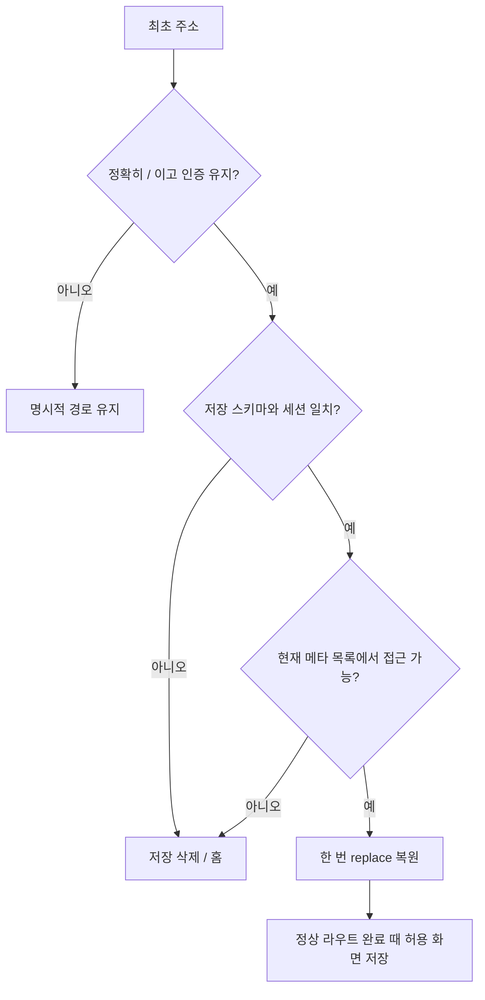

# 모바일 메뉴 이동과 재기동 화면 복원

- status: complete
- baseRef: c9fb51d459080eb87b30621fafd4cab8770651d8
- startedAt: 2026-10-19T11:25:00Z
- 원본: `/Users/jun/develop/personal/personal-memo` (미커밋 변경 없음)
- 작업: `/Users/jun/Documents/Codex/2026-10-19/task/personal-memo`, `codex/mobile-navigation-restore`
- 원격: `git@github.com:Junjak-Personal/personal-memo.git`

## 범위와 수용 기준

1. 모바일 메모 상세 → 메뉴 → 다른 메뉴 이동 시 drawer/라우트 전환 연속성 개선. 기존 저장 가드와 입력 보존.
2. 태그(선택 포함), 캘린더(월·날짜), 메모(홈·개별 상세), 할 일(완료 목록 포함)만 저장.
3. 쿠키 세션이 유지된 앱 재기동의 `/` 진입 때 한 번 replace. query/hash가 있는 진입·딥링크·로그인·기타 경로는 우선.
4. 삭제·읽기 불가 메모, 없는 태그, 손상 상태, 세션 변경은 기본 홈. 원문·제목·본문은 저장하지 않음.
5. 현재 단일 owner 인증의 세션 id·loggedInAt별 저장. 재로그인하면 이전 세션을 복원하지 않음. 인증 방식 변경 시 알 수 없는 세션은 거부.
6. 테스트·Nuxt 타입검사·빌드, 가능하면 격리된 개발 브라우저 확인. 배포·커밋·푸시·설치 없음.

## 구현과 검토

- Nuxt UI 기본 autoClose는 Nuxt route 갱신만 따라 drawer를 닫았다. 재사용 메모 페이지에서는 새 MemoDocument fetch 전에 닫혀 구 메모가 노출되고, 다른 메뉴는 본문 페이드와 drawer slide-out이 겹쳤다.
- 메뉴 열린 이동만 본문 transition duration 0. 목적 페이지 준비/메모 mounted 뒤 기존 drawer slide-out으로 드러낸다. API 지연은 타이머로 추정하지 않는다.
- 요청 sequence + page VNode/문서 setup의 id 캡처로 이전 완료를 무효화한다. 현재 화면 재선택, 가드 거절, 연속 이동 취소, query/별칭 주소 정리를 처리한다. 대기 안내는 고정 높이로 목록 점프를 막는다.
- 메모 저장 가드·autosave·오프라인 draft 구현과 전역 reduced-motion CSS는 변경하지 않았다.
- localStorage에는 version/scope/path만 저장한다. 화면 allowlist와 query whitelist, 손상 방어, 현재 인증의 tree 메타 확인, 최초 1회 replace, 늦은 비동기 저장/복원 무효화를 적용했다.
- 개인정보/인증 검토: 메모 제목·본문을 보관하지 않음. 외부 URL/인증·승인 query를 복원하지 않음. 세션 id·로그인 시각 변경이나 로그아웃은 기록 삭제 및 pending 무효화. 서버 계약·실제 계정·자격 증명은 변경하지 않음.
- 실제 메모·운영 서버/캘린더·기존 dotenv를 열거나 변경하지 않았다. 원본 저장소는 종료 시에도 clean. 커밋·푸시·배포·앱 설치 없음.

## 검증 기록 — VERIFY_PASS

모두 분리 복제본에서 실행했다. package.json의 test/typecheck/build 스크립트와 동일한 로컬 실행 파일을 Node로 직접 호출했다.
pnpm 12가 매 실행에서 자동 의존성 동기화를 시도하며 네트워크 DNS 제한에 막혀, 원본의 node_modules만 독립 복사했다. package/lockfile 변경 없음.

| 검사 | 실제 명령 | 결과/증거 |
|---|---|---|
| baseline 테스트 | `node node_modules/vitest/vitest.mjs run` | 23파일 211개 PASS, `_workspace/baseline-tests.log` |
| 최종 통합 테스트 | `node node_modules/vitest/vitest.mjs run` | 27파일 264개 PASS (추가 53개), `_workspace/integrated-tests.log` |
| Nuxt 타입검사 | `node node_modules/nuxt/bin/nuxt.mjs typecheck` | exit 0, `_workspace/typecheck.log` |
| 프로덕션 빌드 | `node node_modules/nuxt/bin/nuxt.mjs build` | exit 0, 11.2초, `_workspace/build.log`; Vite 큰 청크(500kB) 경고 |
| 공백 검사 | `git diff --check` | PASS |
| 패치 적용 가능성 | `git apply --check` (원본 저장소) | PASS; 실제 적용 안 함 |

추가 테스트: 화면 allowlist/정규화·태그/캘린더 query·경로 id·손상 JSON·스키마·세션 격리·삭제/읽기 불가 메모·없는 태그·차단된 storage·API 오류·늦은 저장과 복원·최초 1회와 deep link·내부 홈/뒤로가기 비침해, 모바일 메뉴 sequence·중복 선택·이전 branch 완료 무시.

### 개발 화면 스모크 (CUA / Mac Chrome)

- 전용 주소 `http://127.0.0.1:4719`, Responsive 400×741, 다크 모드. `_workspace/smoke-data`의 합성 메모 2개, 임시 인증, 구글 동기화 꺼짐으로 실행.
- 메뉴 → A 메모: route 갱신 후 메뉴를 유지하다 준비되면 닫히고 제목/본문/툴바 표시.
- A 상세 → 메뉴 → 캘린더: `/calendar` 정상 표시, drawer 닫힘 확인. 프레임별 애니메이션 측정은 안 함.
- 캘린더 열린 뒤 주소를 정확히 `/`로 다시 로드: `/calendar`와 2026년 10월 화면 복원 확인.
- 저장된 캘린더가 있는 상태에서 명시적 `/m/p%3Asmoke-a.md` 진입: 해당 메모 표시, 캘린더로 덮지 않음.
- 합성 A에 `navigation-input-preserved` 입력: 임시 파일 저장 및 화면 재진입에서 동일 본문 확인. 첫 저장의 경로 id→정식 id 교체 후 `/` 재로드는 그 개별 메모로 복원.
- Console: Suspense 실험 기능 안내 및 기존 Canvas2D 성능 경고. 이 스모크에서 앱 오류는 관찰되지 않음.
- 테스트 서버와 검증용 탭은 종료. 초기 sandbox listen 제한은 로컬 서버에 한정한 실행 승인으로 해결. 연결 DOM 브라우저가 없어서 기존 Chrome의 네이티브 CUA로 확인. 현재 거절·대기·불확실한 작업 결과 없음.

## 문서 정합성 확인

- 이 작업의 processing 문서는 complete/implementation으로 이동하고 project-profile/index에 연결했다. 신규 파일·프로필·SSOT의 설명은 최종 코드/테스트/세션 경계와 대조했다. 임시 학습 파일은 생성하지 않았다.
- `_docs` 및 wiki의 로컬 링크를 확인했다. 변경과 무관한 기존 SSOT의 에메랄드 구현 기록 링크가 옛 active 경로를 가리키는 문제가 남아 있다(`_docs/reference/product-spec/2026-10-06-product-spec.md:362`). 이 작업에서는 수정하지 않았다. 나머지 매칭은 본문 문법 예시의 `assets/...`·`링크`다.
- 별도 공식 _docs/index는 없는 기존 구조를 유지했다. 이번 변경 경로만 lifecycle 정리했고, 기존 complete/handoff 문서는 이동하지 않았다.

## 미검증 플랫폼과 사용자 확인 항목

- iPhone 실기기 WKWebView, 키보드가 열린 상태, 앱 강제종료/웹 콘텐츠 프로세스 재시작은 미검증. Flutter/Swift는 변경하지 않았으며 앱 설치/기기 빌드는 실행하지 않음.
- reduced-motion은 기존 CSS를 유지했으며 실제 OS 설정 변경으로 확인하지 않음.
- 느린 네트워크의 연속 탭/뒤로가기, 저장 오류·offline 상태는 상태 회귀테스트 및 기존 보호 코드 리뷰까지이며 실제 기기 스모크는 남음.
- 재로그인하면 이전 세션 화면을 복원하지 않는 동작, `/todo/done`도 할 일 범위로 포함한 동작을 사용자에게 확인 요청.
- 더 깊은 QA는 별도 요청 시 수행한다. 아래 시나리오는 이번 작업에서 실행하지 않았다.

## Deferred QA

### 2026-10-19-navigation-restore-01
- Priority: P1
- Preconditions: iPhone 개발용 웹뷰, 합성 메모와 키보드 활성, 네트워크 지연
- Actions: A 본문/제목 입력 직후 메뉴로 캘린더·태그 선택, 메뉴 재열기 후 빠르게 B/A 및 뒤로가기
- Expected: 입력 저장/기기 보관, 최신 목적지만 표시, 메뉴 고착/이전 내용 섬광/툴바 점프 없음
- Source: 요청1, 입력 보존·연속 이동 수용 기준
- Status: pending
- Evidence: —

### 2026-10-19-navigation-restore-02
- Priority: P1
- Preconditions: 합성 메모, 서버 저장 거절(충돌/500) 및 offline 두 상태
- Actions: 수정 후 메뉴 이동, 다시 시도·저장 안 하고 이동·재연결 각각 확인
- Expected: 오류 시 원래 문서와 안내, offline 초안 보존, 명시 선택 전 조용한 입력 폐기 없음
- Source: 기존 autosave 가드 보존
- Status: pending
- Evidence: —

### 2026-10-19-navigation-restore-03
- Priority: P1
- Preconditions: iPhone 동일 로그인, 네 범위 각각 마지막 화면 선택
- Actions: 강제종료/콘텐츠 프로세스 재시작, 공유 링크/인증 next로 진입, 로그아웃 후 재로그인
- Expected: 기본 시작만 1회 복원; 명시 진입 우선; 이전 세션 주소 노출 없음
- Source: 요청2, 세션 경계·딥링크 수용 기준
- Status: pending
- Evidence: —

### 2026-10-19-navigation-restore-04
- Priority: P2
- Preconditions: 브라우저 합성 메모/태그, 저장된 경로
- Actions: 메모 삭제/태그 제거/접근 거절, storage 손상/차단 뒤 기본 주소 재로드
- Expected: 기본 홈 또는 복원 없는 정상 진입, 반복 redirect/실패 경로 고착 없음
- Source: fallback·손상 방어 수용 기준 (자동 테스트 통과, 기기 확인 잔여)
- Status: pending
- Evidence: —

### 2026-10-19-navigation-restore-05
- Priority: P2
- Preconditions: iPhone/브라우저 reduced-motion 켬/끔, 다크/라이트
- Actions: 메뉴 → 각 화면 이동과 넓은 PC 일반 탐색
- Expected: 동작 줄이기 시 이동 효과 억제, 일반 탐색/데스크톱 동작·명도 유지
- Source: 절제된 전환·접근성 기준
- Status: pending
- Evidence: —

## 배포 승인 후 원격 통합 (2026-10-19)

- 사용자 「배포 ㄱㄱ」 승인으로 기존 main push → GitHub Actions 배포 절차 진행. 위 「커밋·푸시·배포 없음」 기록은 최초 구현 검증을 마친 시점의 상태다.
- 새 원격 기준: `54d7e6bcd3fe64fef1538abafaaaed4489dc1207`. 기존 기준 이후 8개 사용자 커밋(하단 아이콘·⋯ 메뉴, 빨간 뱃지, 폴더 펼침 저장, OAuth 조사 변경)을 모두 보존했다.
- 충돌은 AppSidebar의 import 한 곳만 수동 통합했다. 원격의 DropdownMenuItem/TreeItem과 새 VNode/router import를 함께 유지하고, 사용하지 않는 NavigationMenuItem은 추가하지 않았다.
- 통합 검증: 28파일 268개 테스트 PASS, Nuxt typecheck exit 0, production build exit 0 (직접 실행한 동일 명령; `_workspace/predeploy-*.log`). 원본 Mac checkout은 clean으로 보존.
- 운영 비밀값·권한·메모 데이터 변경 없이 기존 GitHub Actions 배포 사용. 배포 완료 여부는 Actions run 및 공개 헬스/제공 빌드 확인 결과를 최종 보고한다.
