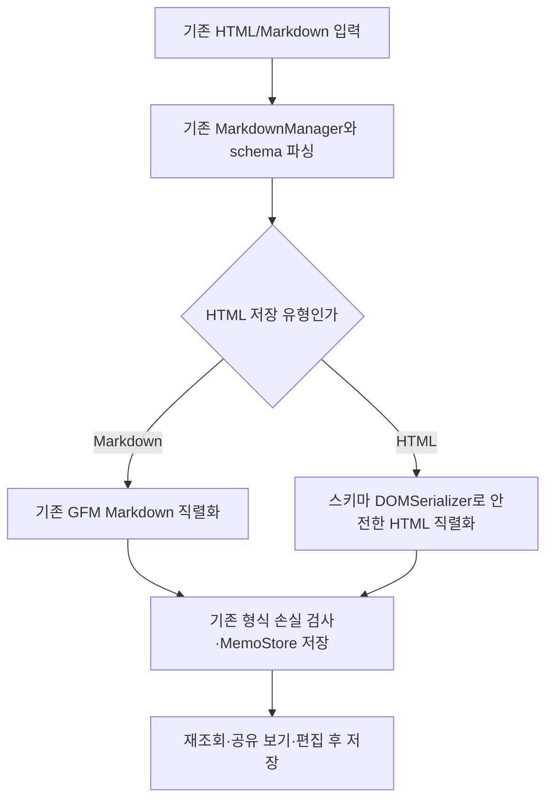

# 에이전트 HTML 표 병합 보존

- status: complete
- verdict: VERIFY_PASS
- completedAt: 2026-10-20 (KST)
- baseRef: 076ffb1c42f3265c53294db9263738879523794e
- startedAt: 2026-10-20T04:44:54Z
- 승인: 에이전트가 본문에 HTML table rowspan/colspan을 쓰면 읽기·저장·보기·편집 후 저장까지 보존. 사람 편집 UI 변경·실제 메모 시험·main push·운영 배포 금지.
- 소유: 주 작업자가 구현/테스트/문서, table_security_review는 읽기 전용 보안·라이브러리 검토.

## 확인한 경계와 설계

기존 TableKit schema는 병합 속성을 읽고 그리며 MemoStore는 본문을 그대로 보관한다. 손실 지점은 Table.renderMarkdown의 GFM 표 변환이다. 파서·공개 API·HTML 허용 범위는 유지한다.



- 명시적인 markdown/html 저장 유형을 같은 table schema 속성으로 구분한다. GFM 입력은 markdown, HTML 입력은 html이고 HTML에 data-memo-table="html"을 저장한다. 병합 해제 후에도 html 유형이 유지된다. 사람 UI/기존 commands는 동일하다.
- HTML 표를 출력하는 Table 확장, 셀 span 값 안전한 정수 처리. image 주소의 저장/표시 구분과 인라인 서식을 보존한다.
- 최초 자동저장 검사에서 단순한 HTML 표 wrapper 정규화만 같은 뜻으로 비교하고, 미지원 HTML/속성 손실 감지는 유지한다.
- 일반 Markdown 표·기존 메모의 직렬화는 기존 경로를 그대로 사용한다. 병합 버튼 등 UI 없음.
- 기존 Vite 기반 별도 로컬 브라우저 회귀 fixture로 실제 DOM 파싱·편집·임시 MemoStore 왕복을 검사한다. 새 의존성이나 제품 테스트 라우트는 추가하지 않는다.

## 수용 검사

1. 가로/세로/동시 병합, 헤더 병합과 문단/굵게/링크 등 내용이 반복 저장 후 유지.
2. HTML 입력 → 임시 저장 → 재조회 → 실제 Editor 파싱 → 관련 없는 편집 → 저장 → 재조회 → readonly 보기에서 span·내용 유지.
3. 일반 Markdown 표는 기존 GFM 출력 유지, 일반 메모·형식 손실 경고 회귀 없음.
4. script/event 속성/위험 링크 비실행·스키마에서 제거, 텍스트 escaping, 잘못된 span 안전 처리.
5. 집중 테스트, 전체 Vitest, Nuxt typecheck/build, 브라우저 fixture 1회 및 통합 diff 검토.

## 증거/진행

- 보안 검토: 기존 DOMParser + ProseMirror schema 경로 유지. 별도 DOMPurify가 있는 것으로 표현하지 않는다. renderMarkdown context에는 editor가 없고 storage는 있다.
- 현재 Node 테스트 환경에 DOM 구현이 없어 HTML 파싱은 실제 브라우저에서 검증한다.

## 브라우저 개발 검사 실패와 조정

- 저장소/Node 집중 검사 78개 통과는 실제 브라우저 왕복 통과를 뜻하지 않았다. 브라우저 fixture에서 사용자와 작업자 모두 10개 중 7개 실패를 확인했다. 기존 TableKit 병합 손실 재현·잘못된 span·GFM만 통과, 나머지는 모두 「표 직렬화에 필요한 스키마가 없습니다」였다.
- 원인: Tiptap Extendable.storage getter가 매번 addStorage를 호출해 객체를 새로 만들고, MarkdownManager도 kit을 다시 펼친다. onBeforeCreate에서 채운 primitive schema storage와 renderMarkdown의 storage가 다른 객체였다.
- 수정: memoExtensions 호출별 memoTableKit 팩토리의 closure에서 schema를 공유해 재펼침에도 같은 schema에 닿게 한다. module 전역 schema는 쓰지 않는다.
- 별도 보안 검토에서 DOMSerializer.fromSchema의 공유 캐시를 직접 바꾸지 않도록 nodes/marks 복제를 추가했다. 저장용 image src와 화면/clipboard용 src가 섞이지 않음을 브라우저 검사에 포함했다.
- 사용자 후속 제안 「mergable table / markdown table」 반영: actual span 유무만으로 출력 종류를 바꾸지 않고 저장 유형을 명시한다. 병합이 없는 HTML 표, 병합 해제 후 HTML 유지, GFM clipboard 왕복을 추가 검증한다.
- Library 이미지 ID libfile_3498a9c7aabc8191ba1bc622def52436의 read 응답은 픽셀을 제공하지 않아 현재 테스트 화면의 동일한 7개 실패 메시지를 근거로 확인했다.

## 최종 변경과 검증

- `app/utils/editor-table.ts`: TableKit을 확장하는 호출별 팩토리. 같은 table node의 `memoTableFormat` 속성으로 markdown/html 저장 유형을 나눈다. GFM은 기존 출력, HTML은 `data-memo-table="html"` 표시와 셀 span을 저장한다. 병합을 모두 풀어도 HTML 유형은 유지된다. 앱 내부 클립보드에는 markdown 표시도 넣어 기존 표를 복사해도 GFM 유형을 유지한다.
- `app/utils/editor-extensions.ts`: 편집/외부 보기의 공통 확장만 교체했다. 사람용 표 툴바/버튼/화면은 수정하지 않았다.
- `app/utils/canonical-table-html.ts`, `useMemoAutosave.ts`: 안전하게 지원하는 HTML 표의 tbody/p 래퍼 차이만 비교에 정규화한다. 미지원 태그/속성, 실제 내용/span/유형 차이, 코드 펜스/들여쓰기 코드의 차이는 숨기지 않는다.
- 셀 span은 1~1000 정수만 허용, 나머지는 1이다. 문자열 보간이나 raw v-html을 추가하지 않았고 기존 DOMParser→ProseMirror schema 처리 경계를 유지했다. 별도 DOMPurify가 있는 것처럼 설명하지 않는다.
- 이미지 저장 경로/화면 URL 분리와 서식을 유지한다. 공유 DOMSerializer 캐시를 복제하므로 후속 getHTML/클립보드의 이미지 URL도 보존한다.

| 실제 실행 검사 | 결과 |
| --- | --- |
| Vitest 전체 | 32파일 326개 통과, exit 0 (기준 31파일 306개) |
| Nuxt typecheck | exit 0 |
| Nuxt build | exit 0, 15.5초 |
| Chrome 실제 브라우저 fixture | **13/13 통과**, `PASS · 13개 회귀 검사 통과` |
| diff whitespace | git diff --check 통과 |
| 최종 읽기 전용 보안/정합성 검토 | 차단 사항 없음 |

브라우저 fixture는 실제 Editor/Markdown/memoExtensions와 mkdtemp 안 실제 MemoStore를 사용한다. 가로·세로·동시·헤더 병합과 병합 없는 HTML 표에 대해 생성→재조회→편집/저장 3회→readonly 표시의 span과 저장 유형을 확인했다. 병합 제거 후 HTML 유지, GFM clipboard 유형 보존, 굵게/기울임/밑줄/취소선/링크/code/escaped 글자·상대 이미지의 2회 저장, script/style/event/javascript 차단, 잘못된 span, 기존 GFM 출력·형식 손실 검사도 통과했다.

Node 테스트는 DOM 없이 직렬화 호환/값 경계 및 MemoStore 보존을 검사한다. 실제 HTML 파싱·보기·편집 왕복 통과는 별도의 Chrome 13개 검사 결과다. 이 구분은 최초 78개 집중 통과와 브라우저 7개 실패에도 똑같이 적용한다.

- 재실행: `node tests/editor-table/run.mjs`, http://127.0.0.1:4731/ 의 「회귀 검사 실행」. `tests/editor-table/README.md` 참고.
- 증거: `_workspace/e2e/2026-10-20-table-spans/{tests,typecheck,build}.log`, `browser-result.txt`, `browser-pass.png`, `browser-server.log`.
- 검토 브랜치 `codex/html-table-spans`. 커밋·main push·운영 배포 없음. 기존 미추적 2개, 실제 사용자 데이터/일지/자격 증명/지속 권한 보존. 검토용 로컬 fixture 서버만 실행 중이다.

## 에이전트 입력 예시

```html
<table data-memo-table="html">
  <tr><th>유형</th><th>오늘 요약</th></tr>
  <tr><td rowspan="2">개발</td><td>구현</td></tr>
  <tr><td>검토</td></tr>
</table>
```

일반 `| ... |` 표는 그대로 Markdown 유형이다. HTML 입력은 표시를 생략해도 HTML 유형으로 읽지만, 에이전트는 명시적인 `data-memo-table="html"`을 권장한다. 서식/셀 span은 에디터 스키마가 지원하는 범위 안에서 보존한다. 이미지·목록·추가 스타일/열 너비 등 복잡한 HTML은 기존 최초 저장 형식 확인이 남을 수 있다. 형식 경고를 모든 HTML에 대해 우회하지 않는다.

## Deferred QA

### 2026-10-20-html-table-spans-01
- Priority: high
- Preconditions: iPhone Safari/Flutter WebView 개발 환경과 별도 합성 메모.
- Actions: 에이전트 HTML 병합 표를 열고 셀 내용·표 밖 문단을 고친 뒤 닫기/재기동, readonly 보기로 재조회.
- Expected: span/HTML 유형/본문이 유지되고 새 병합 조작 UI는 없으며 정상 저장 상태가 나타난다.
- Source: 사용자 플랫폼, 수용 검사 1~2. Chrome fixture는 통과했으나 iOS는 미검증.
- Status: pending
- Evidence: —

### 2026-10-20-html-table-spans-02
- Priority: medium
- Preconditions: 합성 메모에 HTML 표와 목록·이미지·여러 문단·열 너비/정렬 등 복잡한 셀 내용.
- Actions: 기존 사람용 행·열 추가/삭제와 undo를 수행하고 최초 저장 형식 확인 동작 및 반복 저장을 검토.
- Expected: 지원 내용/span은 보존되며 미지원 내용의 손실 가능성은 기존 형식 경고가 알리고 조용히 덮지 않는다.
- Source: 보수적인 canonical 처리, 기존 사람 편집 UI와 복잡한 HTML 경계.
- Status: pending
- Evidence: —

### 2026-10-20-html-table-spans-03
- Priority: medium
- Preconditions: 별도 로컬 테스트 인증의 실제 MCP/API 연결, 합성 메모만 사용.
- Actions: 에이전트 create/update/read 요청으로 HTML 유형 표를 작성하고 앱에서 수정 후 다시 에이전트로 조회.
- Expected: 프로토콜 경유 후에도 content의 HTML 표시/span이 유지되고 충돌/인증 동작이 기존과 같다.
- Source: 이번 브라우저 fixture는 HTTP test middleware와 실제 MemoStore를 검사했고 실제 OAuth/MCP 연결은 사용하지 않았다.
- Status: pending
- Evidence: —

## 문서 정합성

- 이번 실행의 active 계획을 완료 archive로 이동하고 프로필 index/관련 UI 설명/설계 SSOT를 같은 변경에서 갱신한다.
- 경로·활성/완료 수명주기·index 링크·중복 계획·검증 상태·SSOT 정합성의 여섯 관점으로 변경 문서를 확인한다. 이 실행 외 문서는 이동/삭제하지 않는다.
- 범위 밖 기존 프로필 상단의 초기 98 tests/CI 없음 설명은 오래된 초기 생성 내용이다. 이번 변경은 최신 구현 기록 행에 326개와 검증 결과를 명시하고, 관련 없는 상단 정리는 하지 않는다.

- 링크 점검에서 설계 SSOT의 기존 `../../active/processing/2026-10-13-emerald-tags-navigation.md` 대상 부재를 확인했다(기준 HEAD에도 동일 링크). 이번 표 변경과 무관해 수정하지 않았다. 이미지/링크 문법의 예제 경로 2개는 실파일 링크 검사 대상에서 제외한다. 이번 신규 archive/index 링크는 유효하다.

## 조건부 배포 승인과 최종 사전 확인 (2026-10-20 KST)

- 사용자 「문제 없으면 배포해줘」가 앞의 배포 보류를 대체했다. 이번 표 지원 변경만 커밋하고 정상 main push→Deploy Actions 경로로 배포한다.
- origin/main fetch 결과 작업 기준 076ffb1과 일치. 기존 사용자 미추적 두 경로와 원본 checkout은 제외/보존한다.
- 제품 코드는 326개·타입/빌드·브라우저 13개 통과 이후 동일하다. 확인 과정에서 코드 수정이나 의존성/권한 변경 없음.
- 스타일: TableKit의 같은 table/row/cell/header 렌더러, UEditor 공통 app.config.ts CSS, theme 토큰을 사용한다. 저장 유형 표시는 CSS 선택 조건에 없다. 두 표의 th/td 기본 테두리·padding 12px/16px·text-sm·헤더 bg-muted/50 규칙 동일.
- 실제 개발 앱 localhost:4721의 별도 합성 메모에 두 표를 같이 표시해 다크 모드 시각 비교 통과. 증거 `_workspace/e2e/2026-10-20-table-spans/style-app.png`. 운영 데이터나 사용자 일지로 시험하지 않았다. 라이트 모드는 공통 CSS/토큰을 코드로 확인했고 이번 수동 화면 비교는 다크만 수행했다.
- HTML 헤더는 th여야 GFM 헤더와 같은 헤더 스타일을 적용한다. 병합 셀의 배치는 다르며 이는 정상이다.
- iOS 실기기와 실제 OAuth/MCP 연결의 추가 QA는 남아 있으나 공통 웹 렌더러·기존 저장소 경로이며 새 네이티브/인증/UI 계약이 없어 현재 차단 위험은 발견하지 못했다. 복잡한 미지원 HTML은 기존 최초 저장 형식 경고를 유지한다.
- 배포 전 공개 health ok, Nuxt build ca811f6e-6f72-4124-a9db-7eb2752f6610. CI 최종 성공·운영 health·실제 새 컴포넌트 제공을 별도 결과로 확인한다.
