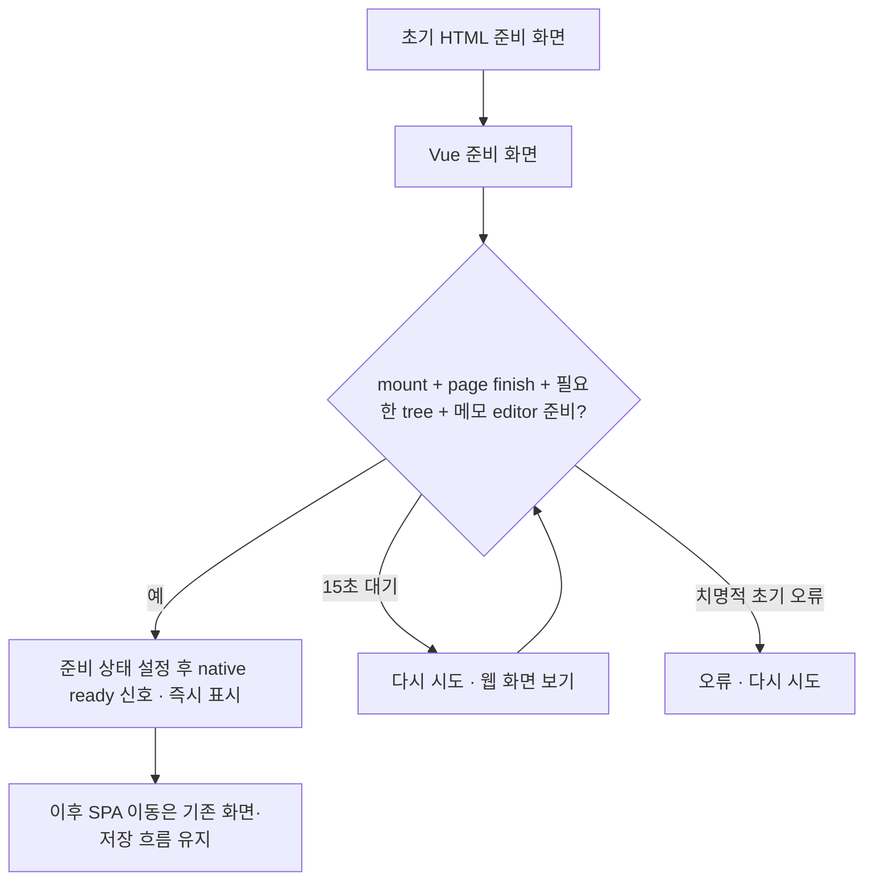

# 첫 실행 준비 화면과 세션별 목록 공유

- status: complete
- verdict: VERIFY_PASS (웹 필수 검사와 네이티브 분석/독립 로직 검사; Flutter runner·에셋 번들·실기기는 별도 미검증)
- baseRef: 13123eb38b91eaf474bb83001eb6ccb47d7d59d6
- startedAt: 2026-10-20T13:13:21Z
- branch: codex/startup-loading
- 범위: 구현·테스트·검토. 배포/push/설치/의존성·권한 변경 없음. 표 너비와 운영 데이터 변경 없음.
- 기존 작업: 원본 checkout과 미추적 `mobile-menu-navigation.test 2.ts`, `node_modules 2/` 보존.

## 설계와 소유권

- parent: 웹 초기 HTML → Vue 준비 화면 인계, 준비 상태/계측, MemoDocument 에디터 준비 이벤트, 통합 검증·문서.
- startup_tree: 세션별 ensure/in-flight 공유, sidebar/복원/태그 초기 조회 연결과 테스트. 명시적 refresh는 새 요청.
- startup_native: MemoStartup 채널과 현재 문서 상태 probe, 네이티브 로딩·오류·15초 지연 안내. 기존 툴바 채널 보존.
- 후속 독립 검토: 인증/목록 격리와 통합 준비 신호.

`window.memoStartup={ready:boolean, failed:boolean}`를 먼저 갱신하고 optional `MemoStartup.postMessage({type:'ready'|'error'})`를 보낸다. pageFinished만으로 완료하지 않는다. 고정 최소 시간 없음. API 오류로 기존 오류 화면이 완성된 경우 그 화면을 표시한다. 늦은 응답·세션 변경은 무효화한다. 계측은 단계 시간/요청 수만 보관하며 주소·메모·계정 정보는 내보내지 않는다.

## 수용·검증

- 복원/사이드바/remember/태그 초기 tree는 세션 안에서 한 요청·결과 공유. mutation refresh와 계정 전환 경합 회귀 테스트.
- 첫 메모는 실제 mounted editor까지 대기. 일반 페이지/로그인/오류·지연 상태 회귀 테스트. 이후 SPA 전환에 splash 재등장 없음.
- 기존 네 화면 복원 제한, 딥링크, 삭제/읽기 불가, 입력/충돌 보존 테스트 유지.
- 통합 Vitest·Nuxt typecheck/build, native 가능한 분석/테스트, 합성 데이터 Chrome 초기 진입 스모크. 미검증 iPhone은 별도 명시.

## 실제 변경

- 웹: `app/spa-loading-template.html`, `StartupSplash.vue`, `useStartupLoading.ts`, `plugins/startup.client.ts`, `utils/startup-loading.ts`, app.vue/main.css, nuxt.config.ts. 초기 HTML은 body의 Nuxt loader여서 루트 Suspense 대기 중에도 보인다. page finish·mount·tree 최종 결과·메모 에디터 준비를 모으고 실제 다음 프레임에 조건을 재검사한 뒤 ready를 한 번 보낸다.
- 메모: MemoDocument의 기존 mounted/attachBridge 지점에 준비 알림만 추가했다. useAsyncData, Suspense의 이전 화면 유지, 저장/충돌/route guard/본문 입력은 유지했다. API 오류는 기존 오류 화면이 mount된 뒤 노출한다.
- 목록: `session-tree.ts`, `useMemoTree.ts`, `useLastScreen.ts`, AppSidebar.vue, TagBrowser.vue. ensure는 요청/유효 결과 공유, refresh는 새 revision, settled는 같은 세션의 최신 refresh 최종 결과를 따른다. 최신 실패를 자동 재시도하지 않는다. 세션 scope 변경은 목록·오류·대기를 지우고 늦은 성공/실패를 무시한다. middleware/plugin에서 toast inject가 가능한 Vue 앱 문맥도 제공했다.
- 복원 실패 cleanup은 처음 읽은 raw 값과 로그인 scope가 유지될 때만 삭제한다. 늦은 이전 검증이 새 계정/새 화면 기록을 삭제하지 않는다. 허용 네 화면·삭제/읽기 불가/없는 태그·딥링크 규칙은 유지했다.
- 네이티브: `app-ios/lib/main.dart`, `lib/startup_loading.dart`, `test/startup_loading_test.dart`, `pubspec.yaml`, `assets/memo-logo.png`. 기존 로고의 바이트 동일 복사이며 새 패키지 없음. ready/error 메시지는 현재 문서 상태를 probe하는 계기로만 쓴다. 문서 generation, 재시도 직후 이전 문서 probe 차단, 타이머 해제, 시스템 색/동작 줄이기, 구버전 웹의 수동 복구를 포함한다.
- 표 너비 코드 `app/app.config.ts` 변경 없음. 서버·SSR·서버 캐시·운영 데이터 변경 없음. 원본 checkout과 기존 미추적 두 경로 보존. commit/push/배포/설치 없음.

## 검증 결과

- 기준: baseRef의 검증된 333개 테스트·타입·빌드. 최종 통합 `node node_modules/vitest/vitest.mjs run`: **37 files / 369 tests PASS**, exit 0. 관련 집중 검사는 5 files / 41 tests PASS.
- `node node_modules/nuxt/bin/nuxt.mjs typecheck`: exit 0.
- `node node_modules/nuxt/bin/nuxt.mjs build --dotenv _workspace/e2e/2026-10-20-mobile-block-scroll/smoke.env`: exit 0, 10.0초.
- 전체 Dart `analyze lib test`: 기존 로컬 해석 캐시를 읽는 /tmp 복사본에서 No issues found, exit 0. 독립 Dart 상태·타이머 harness **9 checks PASS**. Flutter runner의 작성된 5개 테스트는 SDK bootstrap 캐시 쓰기 제한으로 수집 전에 실행 불가. 설치/pub get/SDK 변경으로 우회하지 않았다. 네이티브 build/asset bundle/iPhone WKWebView는 미검증이다.
- 독립 인증/데이터 검토: 세션 간 누출·복원 범위 확대·기존 저장 흐름 손상 없음. paint 직전 latch와 refresh supersede를 terminal로 취급하던 두 경합은 회귀 테스트 후 재검토에서 해소. 새로운 차단 항목 없음.
- 개발 스모크: Mac은 잠겨 native Chrome은 사용할 수 없었으나 앱 내 브라우저를 통해 localhost:4721의 기존 합성 데이터·캘린더 OFF 환경에서 실행했다. 초기 로고를 촬영하고 마지막 메모 복원→editor 준비 뒤 splash 제거, 명시적 메모 reload 딥링크 유지, SPA 메뉴 이동의 이전 문서 유지/스플래시 재표시 없음, 합성 편집의 메모 이동·뒤로가기 후 저장 보존을 확인했다. 합성 편집은 원문으로 복구하고 saved/reload 확인했다. 개발 콘솔 경고는 Vue 앱 문맥 수정 뒤 새 실행에서 사라졌고 오류 없음. 임시 탭·dev 서버 종료.
- `git diff --check` PASS. 새 의존성·권한·자격 증명 변경 없음.
- 증거: `_workspace/e2e/2026-10-20-startup-loading/`의 tests-final.log, typecheck-final.log, build-final.log, native-validation.log, initial-splash.png, editor-ready.png, saved-after-back.png, browser-smoke.txt, browser-startup.json, browser-final.json, dev-final.log.

## 측정 범위와 판단

최종 로컬 warm reload는 plugin 159ms, plugins 166ms, mounted 168ms, tree settled 174ms, editor 243ms, page 333ms, ready **334ms**였다(탐색 시작 기준). 앞선 표본은 342ms였다. 초기 tree fetch는 두 표본 모두 **1회**다. 네트워크별 session/memo ResourceTiming이 이 브라우저에서 제공되지 않아 그 시간 키는 생략했다. 숫자 단계 시간/요청 수만 window.memoStartup 및 html data-memo-startup에 남기며 경로·계정·내용은 남기지 않는다.

이 값은 운영 cold start/이전 버전과의 비교가 아니므로 운영 병목과 단축량을 단정하지 않는다. 코드에서는 이전 복원→sidebar→remember의 독립 tree 조회를 하나로 합친 것이 확인된다. 스플래시는 실제 대기 과정을 설명하며 준비 완료를 늦추지 않는다.

## 문서 정합성

- 설계 SSOT §7.4/§10.2, profile state-management/ui-components/index를 같은 변경에서 갱신했다. 초기 계획은 이 완료 문서로 이동했다.
- 변경 문서에 대해 위치/상태, 인덱스·링크, 코드 근거, SSOT 중복, 활성 문서 잔류, 수집·handoff 기록 보존의 여섯 항목을 확인했다. 이 실행의 active 문서는 남기지 않는다.
- profile/이번 archive의 실제 링크는 유효하다. SSOT의 기존 `../../active/processing/2026-10-13-emerald-tags-navigation.md` 링크가 완료 위치를 가리키지 않는 점은 baseRef에도 있음을 확인했다. 예시 `assets/01JB7X….jpg`와 `[글](링크)`는 문법 예시다. 범위 밖 기존 탐색 기록 링크와 profile index의 오래된 CI 설명은 재작성하지 않았다.

## 웹 운영 배포 승인 (후속)

- 사용자 승인으로 웹 변경만 커밋·push하고 기존 main Actions 배포를 진행한다. native app-ios의 모든 변경·신규 파일은 로컬에 보존하며 커밋·빌드·설치에서 제외한다. 기존 미추적 사용자 파일도 제외한다.
- 기존 MemoNative만 존재하고 MemoStartup이 없는 설치 앱 호환 회귀 테스트를 추가했다. startup ready는 웹에서 완료하고 기존 툴바 채널에는 새 메시지를 보내지 않는다. 아래 실기기 QA는 후속 설치 시 수행한다.
- 웹 staged tree만 `/tmp/personal-memo-web-deploy.MLUPu7`에 추출하고 기존 의존성만 참조해 검증: 37 files / **370 tests PASS**, typecheck exit 0, build exit 0. 초회 tests는 Nuxt 생성 타입 준비 전 시작되어 수집되지 않았고, typecheck로 준비를 완료한 뒤 재실행해 통과했다. native 변경과 기존 미추적 사용자 파일은 추출 후보에 포함하지 않았다.
- 검증 로그: `_workspace/e2e/2026-10-20-startup-loading/web-deploy-{tests,typecheck,build}.log`. 기존 설치 앱의 실제 WKWebView는 미검증이며 호환 계약 검사는 통과했다.

## Deferred QA

### 2026-10-20-startup-loading-01
- Priority: P1
- Preconditions: 명시적으로 허가된 iPhone 개발 설치/기존 Flutter 실행 환경.
- Actions: native asset bundle/build와 작성된 Flutter runner 5 tests 실행, iPhone cold start·로그인·메모 복원·SPA 이동.
- Expected: 책·펜 로고/시스템 색, 실제 editor 이후 한 번만 닫힘, 툴바·입력·저장 보존.
- Source: native 변경과 실기기 미검증 경계.
- Status: pending
- Evidence: —

### 2026-10-20-startup-loading-02
- Priority: P1
- Preconditions: 격리 데이터, 네트워크 지연·오프라인 및 구버전 웹/native 조합.
- Actions: JS 수신 전 실패, session/tree/memo 느린 응답, fatal 오류, retry, 구버전 웹 15초 후 웹 화면 보기.
- Expected: 초기 HTML부터 복구 수단, onPageFinished/15초만으로 ready 없음, 새 문서가 이전 probe로 닫히지 않음.
- Source: 초기 대기·호환성 수용 기준; 로직 테스트 외 장치/네트워크 조합.
- Status: pending
- Evidence: —

### 2026-10-20-startup-loading-03
- Priority: P2
- Preconditions: 운영과 분리된 대표 크기 fixture, 허가된 장치 성능 측정 환경.
- Actions: before/after cold cache를 같은 장치·네트워크에서 반복 측정하고 세션/목록/메모/에디터 시간을 비교.
- Expected: 실제 병목과 요청 단축량을 수치로 판정하며 화면 진입 종류·데이터 크기를 통제.
- Source: 로컬 warm 값만으로 운영 성능을 단정할 수 없는 제한.
- Status: pending
- Evidence: —
