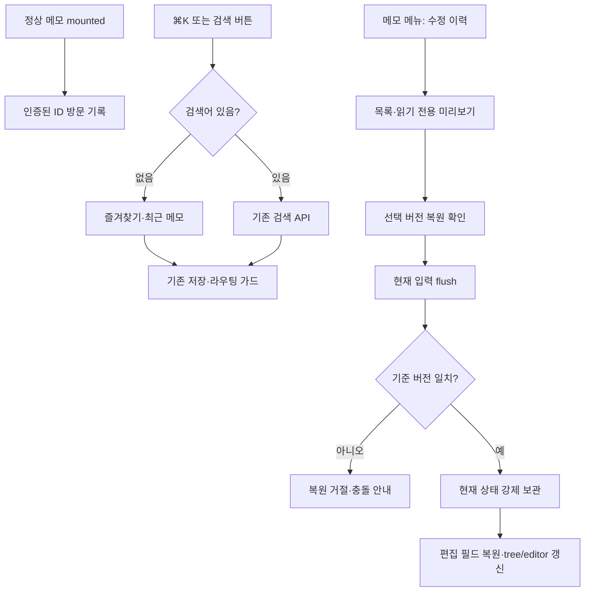

# 최근 메모·즐겨찾기와 수정 이력

- status: complete
- verdict: VERIFY_PASS (자동 검사·격리 API 스모크 통과, 실제 화면 QA는 별도)
- baseRef: 53291afd3d43312446d1f53b45d32df7d274fb52
- startedAt: 2026-10-20T16:10:55Z
- branch: codex/memo-navigation-history
- 사용자 요청: 추천 5개를 이슈로 만들고 1·2번부터 진행. 이번 범위는 구현·검증·기록이며 커밋/push/배포/앱 설치는 별도 지시를 따른다.
- 보존: 사용자 미추적 `app/utils/mobile-menu-navigation.test 2.ts`, `node_modules 2/`. 운영·로컬 실제 data 열람/수정 금지. 브라우저 호출·승인 재시도 중단 유지.

## 동작과 계약

이슈: [#3 빠른 탐색](https://github.com/Junjak-Personal/personal-memo/issues/3), [#4 수정 이력](https://github.com/Junjak-Personal/personal-memo/issues/4), [#5 목차·접기](https://github.com/Junjak-Personal/personal-memo/issues/5), [#6 내부 링크·백링크](https://github.com/Junjak-Personal/personal-memo/issues/6), [#7 템플릿](https://github.com/Junjak-Personal/personal-memo/issues/7).

1. 기존 앱은 계정 여러 개가 아니라 비밀번호로 인증하는 단일 owner 저장소다. 최근 방문(최대20)·즐겨찾기(최대100)는 숨김 파일에 ID만 저장해 PC/폰·재로그인에서도 유지한다. 제목·폴더는 현재 인증된 tree에서 가져오고 읽기 불가/삭제 항목은 숨긴다. 브라우저 메모리와 늦은 응답은 기존 session scope로 격리한다. 향후 다중 계정은 사용자별 서버 저장소가 전제다.
2. 새 빠른 탐색창은 PC ⌘K/Ctrl+K와 사이드바 검색 버튼에서 연다. 빈 검색은 즐겨찾기·최근, 검색은 기존 제목·본문·#태그 API를 재사용한다. 기존 사이드바 검색은 유지한다. 정상 mounted 메모만 방문 기록하고, 이동은 기존 route 저장 가드를 따른다.
3. 수정 이력은 서버의 숨김 디렉터리에 보관한다. 연속 자동저장을 묶고 기간/개수를 제한한다. 저장 전 원본을 남겨 첫 수정도 복원할 수 있게 한다. 이름·폴더가 바뀌어도 ID로 찾는다. 이미지가 있는 이전 버전은 이동/정리 뒤에도 복원 가능한 보관 방법을 사용한다.
4. 이력 API는 목록/상세/복원을 기존 인증 경계 안에 추가한다. 복원에는 baseVersion을 요구하고 현재 파일의 ID·폴더·created·할 일·공개 여부·모르는 frontmatter를 보존한다. 제목·본문·날짜·태그만 되돌린다. 복원 직전 상태는 강제로 보관한다.
5. 메모 메뉴→수정 이력 창. 목록·미리보기·확인 후 복원. 미리보기는 안전한 읽기 전용 원문이며 실행 가능한 HTML로 넣지 않는다. 복원 시 열린 editor를 먼저 flush하고 최신 버전을 재확인한다. 미리보기 중 변경/세션 전환/빠른 선택은 요청 revision으로 무효화한다.

## 파일 소유권

- history backend agent: server/memo/store.ts, 신규 server/memo/history*.ts, 신규 shared/types/memo-history.ts, 신규 server/api/memos/[id]/history/**. 서버 이력·이미지·복원·회귀 테스트. shared/types/memo.ts 변경 금지.
- navigation agent: 신규 server/memo/navigation*.ts, server/utils/memo-navigation.ts, server/api/navigation/**, shared/types/memo-navigation.ts, app/composables/useMemoNavigation*.ts, app/components/MemoQuickSwitch.vue, AppSidebar.vue. 서버 ID 저장·인증 경계·UI 탐색/즐겨찾기. store.ts/MemoDocument/MemoActions 변경 금지.
- parent: MemoDocument/MemoActions 연결·수정 이력 UI/상태·문서·통합 검사·전용 보안 검토.

## 수용 검사

- 기존388개 baseline 재사용(동일 baseRef). 새 기능 회귀: 중복·상한·손상·삭제·이름/폴더/경로ID·세션 전환·늦은 검색/조회·단축키·저장 가드.
- 이력: 初回/묶음/보관 제한·충돌·복원 전 보관·메타 보존·이미지 이동/정리·잘못된 ID/심볼릭 링크·손상·쓰기 실패.
- 최종 전체 Vitest, Nuxt typecheck, 격리 dotenv Nuxt build, diff 검토. 운영 데이터 변경 없음. 브라우저 금지 상태이므로 실제 PC/iPhone 화면 검증은 별도 미검증 항목으로 남긴다.
- 보안 검토: 비인증/외부 공개 이력 접근 금지, 내부 경로 보호, 원문 미리보기 escape, 세션 변경 시 민감 상태 무효화.

## 구현·검토 결과

- #3: 서버 `.navigation.json`에 최근20·즐겨찾기100 ID 저장. 실제 owner 저장소를 사용하므로 재로그인/기기간 유지한다. 클라이언트 session scope와 직렬 요청 큐로 이전 로그인/GET 응답을 버린다. 경로 ID 첫 저장의 즐겨찾기도 이전한다. 빠른 탐색을 열 때 tree/목록을 갱신하고 기존 저장 가드로 이동한다.
- #4: store.update의 기존 배타 큐 안에서 수정 전 snapshot을 보관한다. 복원은 같은 내부 저장/충돌 검사 경로를 재사용하고 편집 필드만 되돌린다. 읽기 전용 원문 미리보기·명시 확인·현재 입력 flush·편집 버전 고정·409 안내/현재 문서 재조회 버튼을 추가했다. 기존 과거 이력을 소급 생성하지 않는다.
- 이력은 지원 로컬 이미지·원본을 별도 보관하고 새 파일명으로 복원한다. 버전당 이미지 합계64MB 상한이며 보관 실패는 현재 파일을 덮지 않고 오류로 전파한다. 읽기/저장 시 만료·50개 상한을 적용한다.
- 전용 보안 검토에서 중단된 최종 snapshot 폴더가 향후 저장을 막는 문제와 비활성/영구 삭제 이력의 무기한 잔존을 발견했다. 최종 ULID 폴더에 직접 쓰지 않고 자체 `.pending-<ULID>-<UUIDv4>`에 완성 후 rename한다. 영구 삭제는 같은 ID의 다른 활성/휴지통 문서를 보호하며 이력도 정리한다. 기존 시작/일일 타이머가 전역 만료 버전과 오래된 자체 staging을 정리한다. 알 수 없는 파일/링크/최근 staging은 건드리지 않는다. 실제 파일시스템 회귀 테스트로 확인했다.
- 기존 메모 파일 형식·표/모바일 drag·자동저장 시점·기존 마지막 화면 복원·인증·공개 여부 정책과 Flutter 소스는 유지했다. 신규 패키지·서버 운영 데이터 접근 없음.

## 실제 검증

- baseline: baseRef53291af의 39 files/388 tests, Nuxt typecheck/build PASS 기록을 재사용했다.
- 최종 `node node_modules/vitest/vitest.mjs run`: **43 files / 434 tests PASS**, exit0,2.74초. 신규46개(이력 저장18·탐색 서버11/클라이언트7·이력 UI 상태10).
- 최종 `node node_modules/nuxt/bin/nuxt.mjs typecheck`: exit0.
- 최종 `node node_modules/nuxt/bin/nuxt.mjs build --dotenv _workspace/e2e/2026-10-20-mobile-block-scroll/smoke.env`: exit0,11.2초. 기존 합성 dotenv·캘린더 OFF만 사용.
- 빌드한 Nitro를 새 시스템 임시 디렉터리·임시 포트·임의 테스트 비밀번호/세션키·캘린더 OFF로 실행해 HTTP 스모크9개 PASS: 비인증 차단, 최근 중복/즐겨찾기, 본문 없는 이력 목록·상세/복원 인증, 공개 응답/이미지 경로 이력 비노출, 구버전409·미덮어쓰기, 복원·직전 이력/공개 상태 유지, 휴지통 숨김/undo, owner재로그인 즐겨찾기, 영구 삭제 이력 제거. 서버는 정상 종료했다.
- 스모크 스크립트 초안의 기대값2개는 기존 계약을 확인해 수정했다: 메모 생성은201이며, 미정의 경로는 SPA200 HTML이다. 앱 소스 실패가 아니었고 이력/비공개 본문 비노출을 응답 본문으로 확인했다. 수정 후 전체 스모크9개 PASS.
- `git diff --check` PASS. 이전 사용자 미추적 파일과 native 변경 없음. 커밋/push/배포/앱 설치 없음.
- 근거: `_workspace/issues/2026-10-21/{created.json,tests-final.log,typecheck-final.log,build-final.log,api-smoke-result.json,api-smoke.log,api-smoke-server.log}`.
- 브라우저 중단 지시는 유지했다. 실제 PC/iPhone 화면·터치·키보드 표시는 이번 quick pass에서 실행하지 않았다. 아래 QA는 명시적인 후속 요청을 기다린다.

## Deferred QA

### 2026-10-21-navigation-history-01
- Priority: high
- Preconditions: PC 개발 화면, 합성 메모2개, 미저장 입력.
- Actions: 본문 조합 입력·⌘K/Ctrl+K·검색·↑↓/Enter·이동 취소/실패·닫기를 확인한다.
- Expected: 입력 보존, editor 링크 단축키와 중복 실행 없음, 목적 문서가 준비되면 정상 이동하고 실패하면 이유가 보인다.
- Source: #3 빠른 탐색·기존 저장 가드.
- Status: pending
- Evidence: —

### 2026-10-21-navigation-history-02
- Priority: high
- Preconditions: iPhone WKWebView 개발 앱, 합성 데이터, 키보드 표시/큰 글자.
- Actions: 사이드바→빠른 탐색, 최근/즐겨찾기 선택, 이력 창의 긴 목록·원문·확인·취소를 터치한다.
- Expected: 중첩 drawer/modal·키보드·안전 여백이 겹치지 않고 버튼/목록 스크롤·포커스가 정상이며 편집 입력을 보존한다.
- Source: #3/#4 모바일 공통 UI.
- Status: pending
- Evidence: —

### 2026-10-21-navigation-history-03
- Priority: high
- Preconditions: 두 개발 클라이언트에서 같은 합성 메모 열기, 네트워크 응답 차단 가능.
- Actions: 한 곳에서 변경 후 다른 곳 복원, 복원 응답 유실 뒤 창 재조회, 로그아웃/재로그인을 수행한다.
- Expected: 다른 변경은409로 보호, 결과 불명인 복원을 자동 반복하지 않고 재조회로 확인, 이전 세션 원문/목록 미노출.
- Source: #4 충돌·세션·실패 정책.
- Status: pending
- Evidence: —

### 2026-10-21-navigation-history-04
- Priority: medium
- Preconditions: PC/iPhone 개발 환경, 합성 경로 ID 메모·폴더·즐겨찾기.
- Actions: 즐겨찾기/최근 방문 후 첫 저장·이름/폴더 변경·휴지통/undo, 다른 기기에서 창 재열기를 확인한다.
- Expected: 최신 제목/폴더·별표 유지, 중복 없음, 삭제 항목 숨김 및 복원 항목 재노출.
- Source: #3 ID 기반 저장·기기간 목록 갱신.
- Status: pending
- Evidence: —

### 2026-10-21-navigation-history-05
- Priority: medium
- Preconditions: 격리 개발 데이터, 이미지/원본 포함 큰 메모와 긴 수정 이력.
- Actions: 5분 묶음 경계·이미지 포함 버전 복원·보관 상한/64MB 실패·앱 재기동 후 이전 내용 확인.
- Expected: 저장/미리보기 반응성 수용 가능, 실패 시 현재 내용 보존, 폴더 이동/정리 뒤 복원한 이미지 표시 정상.
- Source: #4 이미지·보관 제한·실제 화면 성능.
- Status: pending
- Evidence: —
