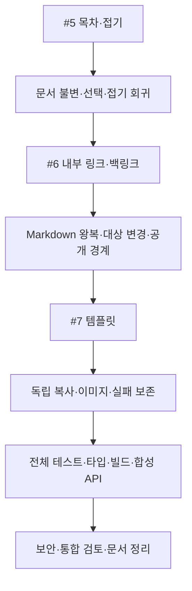

# 목차·접기 → 내부 링크·백링크 → 내 템플릿

- status: complete
- verification: VERIFY_PASS
- qa: pending (5 scenarios)
- baseRef: 53291afd3d43312446d1f53b45d32df7d274fb52
- baseWorkingTree: #3/#4의 미커밋33개 파일, 43 files/434 tests·타입/빌드·합성 HTTP9 PASS. `_workspace/issues/2026-10-21-remaining/prior-navigation-history-files.json` 및 patch로 기록했다.
- startedAt: 2026-10-20T16:37:00Z
- branch: codex/memo-outline-links-templates
- 범위: [#5](https://github.com/Junjak-Personal/personal-memo/issues/5) → [#6](https://github.com/Junjak-Personal/personal-memo/issues/6) → [#7](https://github.com/Junjak-Personal/personal-memo/issues/7) 순차 구현·검증·문서/이슈 갱신. 커밋/push/배포/앱 설치 없음.
- 금지/보존: 실제 data·운영 데이터 열람/수정 금지, 기존 #3/#4와 사용자 미추적 test2/node_modules2 보존. 브라우저 권한/파일 업로드 재시도·권한 우회 없음. 검증은 임시 파일/합성 HTTP·캘린더 OFF.

## #5 계획

- 헤더 「목차·접기」 팝오버에 제목별 이동과 접기 버튼. 제목 단계별 들여쓰기·접근성·모바일 터치 영역.
- 접힘은 ProseMirror plugin state/decorations에만 존재한다. Markdown·노드 attrs·원문·실행 취소/자동저장을 바꾸지 않는다.
- 접힌 본문 안의 선택/목차 이동/검색 진입 시 펼쳐 숨은 커서 편집을 막는다. heading 변경/삭제·중첩 제목·거래 mapping을 처리한다. 블록 이동 모드 진입은 펼치고 접기를 비활성화한다.
- 파일 소유권: outline agent는 신규 `app/utils/memo-outline*.ts`, 신규 `app/pages/m/_modules/MemoOutline.vue`만. parent는 MemoDocument 연결·main.css·문서/통합 검사.

## #6 계획

- `[[` 입력으로 메모 선택·없는 제목 명시 생성, UI에는 최신 제목·저장은 ID 기반 표준 Markdown 링크. 기존 URL 링크/외부 도구 읽기 호환을 유지한다.
- 코드 블록/인라인 코드와 이미지를 내부 링크로 오판하지 않는다. 삭제 대상은 안전한 빈 상태, 중복 제목은 폴더로 구분. 경로 ID 대상은 사용자 선택 때 명시적으로 안정 ID를 보장한다.
- 백링크는 인증된 활성 메모만, 공개 페이지에서는 내부 링크를 비활성화하고 참조 목록·비공개 제목을 조회하지 않는다. 그래프 제외.
- 상세 API/파일 소유권은 #5 검사 뒤 확정한다.

### #5 구현·회귀 결과
- MemoOutlineExtension의 plugin state/decoration + 헤더 MemoOutline 팝오버를 연결했다. nested/same-parent 제목 경계·선택 숨김 방지·삭제/mapping·검색 진입 펼침·블록 이동 비활성화를 처리한다.
- 실제 ProseMirror 회귀9개 PASS, 이후 heading 내부 참조 label 회귀를 더해10개 PASS. 첫 타입검사에서 테스트 helper2곳의 타입 오류가 나와 수정했으며 이후 Nuxt typecheck PASS. 실제 DOM/시각 조작은 미실행.
- `issue5-tests.log`와 agent의 typecheck exit0 결과. UI 변경은 접기 class만 CSS에 추가했고 원문/저장 타이밍 변경 없음.

### #6 확정 계약·소유권
- 저장은 표준 `[표시 제목](/m/<ULID>)`. editor 전용 inline atom/커스텀 tokenizer가 해당 링크만 인식하며 일반 링크·코드는 유지한다. 화면 제목은 인증된 최신 tree로 표시하고 fallback만 저장한다. 공개에서는 링크를 비활성 텍스트로 그리며 비공개 최신 제목/백링크 조회 없음.
- `[[` 입력 중 선택 UI, 중복 제목 폴더 구분, 없는 제목은 명시적인 생성 후 연결. source flush/요청 scope·원문 범위를 검증해 대기 중 다른 입력을 덮지 않는다.
- 서버: `GET /api/memos/:id/backlinks`와 `POST /api/memos/:id/link-target`(필요 시 경로 ID에 영구 ID만 부여). 활성 메모 원문에서 표준 내부 링크/HTML 표 링크를 스캔하되 code/이미지/escape는 제외한다. 경로 ID 부여는 현재 내용/모르는 메타를 유지한다.
- links backend agent: shared/utils/memo-links.ts/test, shared/types/memo-links.ts, server/memo/links*.ts/test, store.ts 신규 메서드, /backlinks·/link-target API, 필요한 navigation ID 이전 helper만. parent는 UI와 editor 확장 등록/MemoDocument/공개 화면 연결. 다른 기존 #3/#4 코드 의미 변경 금지.

## #7 계획

- 메모 메뉴에서 저장 전 현재 입력 flush→이름 지정해 독립 템플릿 보관. 관리 창에서 목록/이름 변경/삭제·폴더 선택 후 새 메모 생성.
- 새 ID/생성시각, 날짜 초기화·태그 유지·할 일/공개 해제. 원본 메모/템플릿 편집은 서로 독립. 표/체크리스트 원문 유지, 로컬 이미지·원본은 독립 보관/복사한다.
- 상세 API/파일 소유권은 #6 검사 뒤 확정한다.

### #6 구현·회귀 결과
- ID 기반 표준 Markdown inline atom·최신 tree 제목·`[[` 선택/명시 생성·백링크를 연결했다. 일반 링크/코드/이미지 호환을 유지한다. 공개 renderer는 비활성 텍스트가 기본이며 일반 Link mark로 남는 참조형 문법도 DOM 경계에서 내부 href를 제거한다.
- 경로 ID 부여는 YAML id 항목만 바꿔 원문/모르는 키/주석을 보존한다. 보안 검토의 승격↔즐겨찾기 경쟁은 navigation queue 안의 promotion callback으로 묶었고, 이미지 alt 복수 링크/emoji masking/코드 fence 오판을 회귀 검사로 고쳤다.
- 관련7 files/79 tests PASS, editor 전용13 tests PASS 포함. Nuxt typecheck PASS. 처음 타입검사의 test/DOM listener 타입 오류는 수정했고 공개 guard 테스트의 잘못된 ULID fixture도 수정한 뒤 통과했다. 실제 화면은 미실행.
- 근거 `issue6-tests.log`, `issue6-parent-tests.log`, `issue6-editor-typecheck.log`, `issue6-backend-tests.log`. 검증 완료 후 #7 시작.

### #7 확정 계약·소유권
- `GET/POST /api/templates`, `GET/PATCH/DELETE /api/templates/:id`, `POST /api/templates/:id/memos`로 목록·저장·미리보기·이름 변경·삭제·독립 인스턴스를 제공한다. 저장 입력 `{memoId,name,baseVersion}`, 생성 입력 `{folder}`.
- 단일 owner의 숨김 `.templates`에 원문/태그/이미지·원본을 독립 보관한다. 최대100개, 이름200자. 날짜/할 일/공개는 새 메모에 승계하지 않는다. 본문 체크 상태는 구성의 일부로 그대로 복사한다. 원본 메모/생성 메모/템플릿이 서로 덮어쓰지 않는다.
- templates backend agent: shared/types/memo-templates.ts, server/memo/templates*.ts/test, template-assets.ts, image-refs.ts, store.ts 새 메서드·/api/templates/**. 확장 승인 범위는 images.ts/test의 HTML 참조·GC 경계와 history.ts/test의 이미지 열거/경로 치환만이다. 기존 이력 정책은 보존한다.
- templates UI agent: 신규 MemoTemplatesDialog·MemoSaveTemplateDialog·useMemoTemplates/test. parent: MemoActions 저장 버튼·Sidebar 관리 진입·통합/문서/최종 검사. 브라우저/운영 데이터 없음.

## 검증 계획

- 이슈별 관련 회귀 검사·수용 조건을 완료한 뒤 다음 이슈를 시작한다. 기존434개 기준의 net-new failure가 없어야 한다.
- 전체 Vitest·Nuxt typecheck·격리 dotenv build·임시 Nitro API 스모크. 데이터·auth·원문을 다루는 #6/#7 전용 보안 검토.
- 브라우저 호출 중단 상태이므로 실제 PC/iPhone 시각·터치 QA는 별도 pending으로 기록한다. 실행하지 않은 플랫폼을 통과로 표기하지 않는다.
- 구조/상태/저장 계약은 기존 profile과 SSOT에 반영하고 이번 active 문서만 완료 시 archive한다. 이전 #3/#4 기록은 보존한다.

## #7 구현·검토 결과

- 메뉴 저장·관리 창·이름 변경·삭제 확인·폴더 생성과6개 API를 연결했다. 표/체크 상태/태그·지원 로컬 이미지와 원본은 독립 복사한다. 새 ID/날짜·할 일·공개 초기화, 중복 파일명 처리, 원본 영구 삭제 후 생성과 템플릿 삭제 후 인스턴스 유지가 실제 FS 회귀에 포함된다.
- UI16개 상태 회귀는 flush 후 ID/버전 캡처, 연속 선택·계정/문서 전환, 닫은 창의 늦은 응답, 실패/중복 생성 차단을 검사한다. 생성 뒤 탐색 실패는 생성된 메모를 보존하며 다시 POST하지 않는다.
- 전용 보안 검토에서 API 버전32hex 불일치와 이미지 열거의 GC 누락 가능성을 발견해 수정했다. 중첩/들여쓴 목록·HTML 표, 엔티티/인코딩 폴더, quoted 속성의 comment/backtick, 유효한 inline backtick 뒤의 실제 참조를 보존한다. 모호한 들여쓰기만으로 파일을 삭제하지 않으며 명백한 fenced/inline/raw code 예시는 제외한다. HTML 경로 치환은 원문 위치만 바꾼다. 공개 이미지 allowlist는 실제 img와 Markdown 참조만 허용하고 숨김 경로를 제외한다.
- 원본/템플릿 경로·손상 manifest·심볼릭 링크·상한·실패 정리·오래된 정확한 staging만 삭제하는 경계를 검토했다. 기존 이력 이미지 capture/restore 열거만 공용 parser로 연결하고 기존 보관/복원 정책은 유지했다.
- 검증 환경 문제: 하위 작업의 pnpm exec가 자동 복원을 시도하며 의존성 링크를 소실시켰다. 두 세션을 중단했고 다운로드는 DNS 실패했다. offline 복원도 캐시 tarball 부재로 실패했다. package.json/lock hash가 동일한 `/Users/jun/develop/personal/personal-memo/node_modules`만 작업 저장소에 복사해 런타임을 복구했다. 패키지/잠금 파일 변경·새 의존성 설치 없음. 이 경로의 memo data는 열지 않았다. 이후 직접 node runner만 사용했다.

## 최종 실제 검증

| 구분 | 명령·범위 | 실제 결과 | 근거 |
|---|---|---|---|
| 전체 회귀 | `node node_modules/vitest/vitest.mjs run` | 51 files / 540 tests PASS, exit0. 기존434개 포함 | `tests-final.log` |
| 타입 | `node node_modules/nuxt/bin/nuxt.mjs typecheck` | PASS exit0 | `typecheck-final.log` |
| 빌드 | `node node_modules/nuxt/bin/nuxt.mjs build --dotenv _workspace/e2e/2026-10-20-mobile-block-scroll/smoke.env` | PASS exit0, 큰 client chunk 경고 유지 | `build-final.log` |
| 합성 HTTP | 자체 mkdtemp 데이터·임시 비밀번호·캘린더 OFF의 Nitro 빌드 | 인증·#3/#4 회귀9 + #6 링크4 + #7 템플릿4 = 17 PASS, exit0. 소유 서버 종료 | `api-smoke.mjs`, `api-smoke.log`, `api-smoke-result.json` |
| 보존/공백 | hash 대조·`git diff --check` | 사용자 test2 동일·node_modules2 존재·native 변경 없음·HEAD53291af 유지·공백 PASS | `preservation-check.json` |

- 모든 로그/검증용 스크립트는 ignored `_workspace/issues/2026-10-21-remaining/` 아래다. 로컬/운영 memo 데이터는 조회·수정하지 않았다.
- HTTP 첫 실행은16개까지 통과했으나 새 runner가 DELETE 상태를200으로 잘못 기대했다. 실제 API 코드/응답204를 확인해 기대만 정정하고 같은 빌드를 새 임시 데이터에서 재검사해17개 PASS했다. 최초 실패 로그/결과는 `api-smoke-first*`에 보존했다. 제품 오류로 분류하지 않았다.
- 보안 검토 발견 사항(승격 경쟁·공개 링크 fallback·이미지 alt 링크 오판·버전 형식·이미지 GC 맥락/경로)을 수용하고 회귀에 반영했다. `imageRefs`는 들여쓰기만으로 code를 확정하지 않아 모호한 참조를 보수적으로 유지한다. 광범위한 Markdown/HTML parser 교체는 하지 않았다.
- 최종 verdict **VERIFY_PASS**: 필수 자동 gate 모두 실행했고 baseline 대비 새 실패 없음. 실제 PC/iPhone DOM·시각·터치, 네이티브 WebView·서버 재기동 화면 체감은 미검증이다. 브라우저/권한/파일 업로드 재시도 없음.
- #3/#4 핵심 controller·기존 API·이력 UI·자동저장·native 사용자 작업은 보존했다. 통합 진입점/서버 신규 메서드와 이미지 열거만 확장했다. 커밋·push·배포·앱 설치 없음.

## 외부 이슈 갱신 제한 (이전 구현 시점 기록)

- #5/#6/#7 원문을 읽어 구현과 대조했고, 계획·구현·실제 검증·미배포/화면 미검증을 구분한 갱신 본문을 `issue5-body.md`~`issue7-body.md`로 준비했다.
- `gh issue edit 5~7 --body-file ...` 실행 요청은 자동 승인 심사가 거절했다. 사유는 구현·검증 승인만으로 공개 GitHub 이슈 본문의 정확한 수정까지 명시 승인된 근거가 없다는 것이다. 도구가 실행 전에 거절했으므로 이 요청의 이슈 변경은 실행되지 않았다. 우회/재시도하지 않았다.
- 미완료 대상: GitHub `Junjak-Personal/personal-memo` 이슈 #5/#6/#7의 진행 본문. 필요한 승인: 준비한 본문으로 공개 이슈 진행 기록을 갱신하는 명시적 사용자 승인. 코드/자동 검증 완료와 별도로 남긴다.

## Deferred QA

### 2026-10-21-outline-links-templates-01
- Priority: P1
- Preconditions: 개발용 합성 긴 메모, PC와 iPhone WebView; 실제 데이터 사용 금지.
- Actions: 중첩 제목을 접고 목차 이동·편집·PC 찾기·블록 모드 전환을 순서대로 수행한다.
- Expected: 숨은 커서 편집이 없고 필요한 범위가 펼쳐지며 본문·undo·자동저장이 유지된다. 모바일 키보드/스크롤이 불필요하게 튀지 않는다.
- Source: #5 수용 조건, plugin 회귀 외 실제 DOM/플랫폼 경계.
- Status: pending
- Evidence: —

### 2026-10-21-outline-links-templates-02
- Priority: P1
- Preconditions: 합성 중복 제목·경로 ID 메모, 느린 네트워크 설정의 개발 화면.
- Actions: `[[` 선택/없는 제목 생성 중 한글 IME·취소·다른 메모 이동·연속 입력, 내부 링크로 이동/뒤로가기를 수행한다.
- Expected: caret 팝오버·터치 선택이 자연스럽고 늦은 응답이 새 입력을 덮지 않으며 자동저장·기존 경로 guard를 따른다.
- Source: #6 링크 UI·명시 생성 및 편집 보존.
- Status: pending
- Evidence: —

### 2026-10-21-outline-links-templates-03
- Priority: P1
- Preconditions: 합성 공개 메모에 inline/참조형/HTML 내부 링크와 외부 링크 포함. 비로그인 PC/iPhone.
- Actions: 공개 화면에서 내부 링크를 클릭/키보드 조작하고 일반 외부 링크를 연다. 별도 인증 화면에서 대상 이름·폴더 변경/휴지통 복원을 확인한다.
- Expected: 공개에서 비공개 제목/백링크 요청이나 내부 탐색이 없고 일반 외부 링크는 유지된다. 인증 화면의 최신 제목/백링크가 현재 상태를 따른다.
- Source: #6 공개 정보 경계·실제 DOM 관찰.
- Status: pending
- Evidence: —

### 2026-10-21-outline-links-templates-04
- Priority: P1
- Preconditions: 합성 표·체크리스트·이미지/원본 메모, PC와 모바일 개발 화면.
- Actions: 미저장 편집에서 템플릿 저장→이름 변경→폴더 선택/새 메모→원본/템플릿 삭제를 확인한다.
- Expected: 터치 영역·스크롤·표/수동 개행/이미지가 유지되고 원본/인스턴스 편집이 독립적이다. 날짜·할 일·공개는 초기화된다.
- Source: #7 수용 조건, FS/API 자동검사 외 화면 흐름.
- Status: pending
- Evidence: —

### 2026-10-21-outline-links-templates-05
- Priority: P2
- Preconditions: 합성 개발 세션, 응답 지연·실패와 계정 세션 갱신을 재현할 환경.
- Actions: 미리보기/저장/생성 중 세션을 바꾸고, 생성 응답 후 화면 전환 실패 및 목록 재시도를 수행한다.
- Expected: 이전 세션 이름/원문이 즉시 지워지고 늦은 응답이 표시되지 않는다. 이미 만든 메모는 재생성 없이 열 수 있고 실패 이유가 보인다.
- Source: #6/#7 비동기 경계, controller 회귀 외 실제 modal lifecycle.
- Status: pending
- Evidence: —

더 깊은 QA는 별도 사용자 요청 때 위 ID의 verdict/evidence를 갱신한다.

## 후속 릴리스 준비 (2026-10-21)

- 사용자의 후속 지시로 이슈 결과 반영·커밋·PR 검토/CI·웹 운영 배포를 승인받았다. 앞선 커밋/배포 금지는 구현 당시 범위이며 이번 후속 단계는 별도다. 앱 설치·브라우저/업로드 재시도는 여전히 하지 않는다.
- 이전 이슈 본문 갱신 거절은 실행되지 않았음을 확인한 뒤 새 승인 근거로 한 번 재시도했고 #5/#6/#7 본문 반영에 성공했다. 이후 PR/배포 결과는 해당 이슈와 PR에 실제 링크로 남긴다.
- 배포 전 독립 읽기 전용 검토에서 HTML 표의 multiline 속성/셀에 fence 문자가 있으면 실제 이미지를 놓치는 P1을 추가 발견했다. 사전 마스킹 대신 HTML 문맥 안에서 fence를 해석하고, GC/공유 보존의 보수적 열거와 공개 허용 목록의 strict 열거를 분리했다. 실제 FS의 GC→템플릿 생성/이력 복원과 공개 경계 회귀를 추가했다. 재검토에서 추가 중대 차단 사항 없음.
- 전체51 files/542 tests PASS(이전540+2), 관련 FS/이미지/이력/store106개 PASS. 릴리스 최종 타입·빌드·합성 HTTP·원격 CI는 `_workspace/issues/2026-10-21-release/`와 PR의 실제 결과를 따른다.
- 기존 workflow에 main 대상 PR verify만 추가하고 deploy는 main의 non-PR 이벤트로 제한했다. Actions 이미지의 OCI revision 라벨로 실제 운영 버전을 확인한다. 데이터 볼륨·비밀·지속 권한은 바꾸지 않는다.
- PC/iPhone 실제 화면 QA5개는 pending을 유지한다. 최종 배포 성공 여부는 이후 PR/Actions/운영 확인 결과로 구분한다.

- 릴리스 테스트 inventory 확인:51개 파일의 parameterized case 실행 결과542 tests PASS. 사용자 미추적 `mobile-menu-navigation.test 2.ts`는 기존 `**/*.test.ts` 패턴에 해당하지 않아 수집되지 않는다. 로컬·커밋 범위가 같으며 이 사용자 파일과 node_modules2는 스테이징에서 제외했다.
- 이번 로컬 타입 재검사에서는 의존성 안의 중복 `*.d 2.ts`가 없는 선택 의존성 `ai`를 요구해 실패했다. 소스 오류와 구분하고 byte-identical 의존성 사본 일부는 ignored 작업 폴더에 보존한 채 격리했다. 장시간 중복 스캔은 소유 프로세스만 중단했다. PR CI의 깨끗한 설치 환경에서 타입·빌드 통과를 필수 조건으로 둔다.
