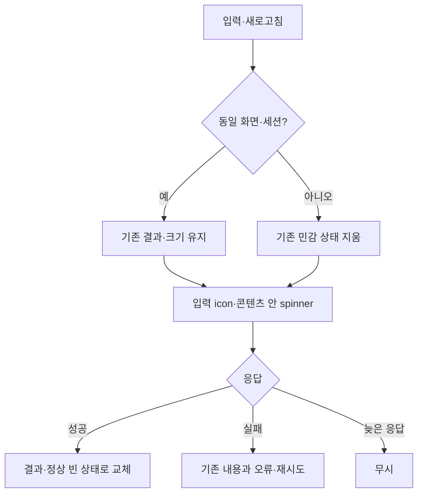

# 로딩 상태로 인한 화면 높이 변화 정리

- status: complete
- verification: VERIFY_PASS
- qa: pending (5 scenarios)
- baseRef: 575721cd851225f28c57a1d183e9e327b5326152
- branch: codex/sidebar-search-spacing
- startedAt: 2026-10-21T13:42:32.783077+00:00
- 범위: 빠른 열기·사이드바 검색·참조 목록·이력/템플릿의 관련 불러오기 상태. 새 배포/push/설치·브라우저 승인 재시도·실제 memo 데이터 조작 없음. 이전 검색 메뉴/간격 수정은 patch/hash로 보존했다.

## 원인·최소 재현
- 첨부 빠른 열기 화면 직접 확인: 검색과 최근 목록, 하단 키 안내가 같은 모달 body 흐름 안에 있다.
- MemoQuickSwitch의 loading p가 space-y-3의 새 행으로 삽입되고, createMemoQuickSearch.reset/onInput이 기존 결과를 지운다. 이 두 변화로 목록과 footer가 움직이며 가운데 정렬 모달의 입력도 이동한다.
- 검색 재요청 직후 이전 결과가 남는지 deferred Promise 회귀로 수정 전 실패를 확인한다. 로딩/빈 상태가 list viewport 밖의 별도 행인지 컴파일 AST로 검사한다.

## 설계·소유권
- root: QuickSwitch + memo-navigation/test, AppSidebar의 검색 loading indicator만, 새 MemoLoadingRegion, backlink UI/controller/test, SSOT/plan/통합 검사.
- related dialogs agent: MemoTemplatesDialog/useMemoTemplates/test, MemoHistoryDialog/useMemoHistory/test만. 다른 파일 수정 금지.
- 빠른 열기만 기존 최대 목록 높이 안에서 viewport에 맞는 결과창을 사용한다. loading/error/empty는 그 안에서 바뀌고 input leading icon의 고정 칸에 spinner를 표시한다. 다른 모든 화면에 큰 고정 높이를 적용하지 않는다.
- 공용 MemoLoadingRegion은 기존 콘텐츠 안의 비차단 absolute spinner와 sr-only status를 제공한다. 로딩 시작 시 실제 직전 높이만 일시 보존하고 완료 때 해제한다. 데이터 양에 따른 정상 크기 변화와 로딩 행 삽입을 구분한다.
- 같은 검색/문서/세션의 재요청은 기존 결과 유지, 새 query의 debounce도 기존 표시 유지. 닫기/로그아웃/문서 전환은 원문을 즉시 지우고 늦은 응답을 버린다. 미리보기 loading 동안 이전 항목을 잘못 복원/생성/이름 변경하지 못하게 한다.

## 검증
- 수정 전 실패하는 재검색 보존/세션 reset 회귀 → 수정 후 pass. DOM/CSS 위치 계약·이전 메뉴 회귀·원문/미리보기 선택 보호.
- 관련 tests, 전체 Vitest, Nuxt typecheck → build 순서. 검사한 같은 코드의 gate는 반복하지 않는다.
- 사용자 Mac의 브라우저 화면 검증은 기존 중단 지시를 따르며 승인 재시도하지 않는다. 이번 실행에서 실제 화면을 확인하지 못하면 명시한다.

## 구현 결과
- `MemoQuickSwitch`: 입력 아이콘 칸에서 로딩 표시. 목록·정상 빈 결과·오류를 같은 화면 높이 제한 viewport 안에서 전환해 입력/하단 키 안내를 유지한다. viewport는 이 창에만 적용하고 모바일 키보드에 맞춰 dvh로 줄어든다.
- `createMemoQuickSearch`: 요청 취소/준비와 전체 초기화를 분리했다. 재검색·IME·실패 동안 기존 결과를 유지하고, 첫 검색 전에는 최근·즐겨찾기를 유지한다. 성공한 빈 결과는 정상 빈 상태로 전환한다. 닫기/계정 변경은 원문까지 지우고 sequence·AbortSignal로 늦은 응답을 무시한다.
- `MemoLoadingRegion`: 콘텐츠 안 absolute·pointer-events-none spinner와 sr-only live status. 이전 실제 높이만 loading 동안 보존하고 완료 때 해제한다. 모든 화면에 큰 고정 높이를 부여하지 않는다.
- 이력·템플릿 목록/미리보기와 백링크의 같은 문서 재조회는 직전 데이터를 유지한다. 이력·템플릿의 `selectedReady`는 새 선택 대기/실패 중 이전 preview를 대상으로 변경·삭제·생성·복원하지 못하게 UI/controller 양쪽에서 막는다. 문서/계정/닫기는 sync 초기화한다.
- 사이드바는 기존 검색 입력의 spinner/aria-busy만 추가했다. 이전 검색 메뉴·간격 코드와 새 메뉴 util/tests의 보존을 hash 비교로 확인했다(`preservation.json` 모든 항목 true).
- 첨부 Library 이미지는 공식 materialize helper로 내려받아 직접 확인했다. 브라우저나 실제 memo `data/`는 열지 않았다. 이미지에는 개인 메모가 있으므로 결과 문서에 본문을 옮기지 않았다.

## 실제 검증 결과
| 검사 | 명령/근거 | 결과 |
|---|---|---|
| 수정 전 회귀 | `before-tests.log`, `dialog-before.log` | 재검색 보존 1개·관련 dialog 4개 실패 확인 |
| 관련 root 회귀 | direct Vitest 5 files (`focused-tests.log`) | 38개 PASS |
| 관련 dialog 회귀 | direct Vitest 2 files (`dialog-after.log`) | 32개 PASS |
| 전체 회귀 | `node node_modules/vitest/vitest.mjs run` (`all-tests.log`) | 53 files / 565 tests, exit 0 |
| AST helper 타입 정정 후 해당 회귀 | direct Vitest `app/utils/loading-layout.test.ts` (`layout-final.log`) | 3개 PASS, 나머지 562개는 동일 코드의 위 전체 결과 재사용 |
| 타입검사 | `node node_modules/nuxt/bin/nuxt.mjs typecheck` (`typecheck-final2.log`) | exit 0. 최초/2차 검사의 새 테스트 AST helper 타입 불일치는 실제 compiler AST 유니온으로 정정 |
| 프로덕션 빌드 | `node node_modules/nuxt/bin/nuxt.mjs build` (`build.log`) | exit 0, Build complete |
| diff 확인 | `git diff --check` | exit 0 |
| 전용 보안 검토 | 아래 참조 | 확정 문제 없음. 실제 브라우저/서버 권한 전환 미실행 |

- 로그 기준 경로: `_workspace/issues/2026-10-21-stable-loading/` (로컬 검증 자료, Git 제외).
- node_modules의 기존 ` 2.js` 중복 import 경고가 타입/빌드에 남아 있으나 오류는 없다. 의존성 설치·정리는 하지 않았다.
- API/저장 계약·서버·네이티브 소스는 변경하지 않았다. 실제 데이터/API 쓰기 검증은 실행하지 않았다.
- **사용자 Mac의 브라우저 화면 검증은 실행하지 않았다.** 이전 승인 반복 중단 지침에 따라 새 브라우저 호출/승인 요청·업로드 재시도·권한 우회는 0회다. 따라서 실제 픽셀 높이·Safari 키보드 레이아웃·iPhone 실기기 결과를 확인했다고 주장하지 않는다.
- 커밋·push·배포·앱 설치 없음. base HEAD와 작업 브랜치는 유지한다.

## 전용 보안 검토
- QuickSwitch close/scope watch → reset으로 retained 본문 삭제, sequence/abort 및 active/scope 검증으로 늦은 응답 차단.
- Navigation generation/scope reset, backlinks id/scope sync clear와 응답 token, templates/history close/scope invalidation 확인.
- `selectedReady` 및 loading/selecting guard로 이전 preview의 잘못된 생성/이름 변경/삭제/복원 차단. 기존 flush·baseVersion 충돌 계약 유지.
- 첫 저장 `p:`→ULID 예외는 현재 `MemoDocument` 소유 autosave.currentId 계약과 문서별 key/unmount에 의존한다. 다른 문서 ID를 반환하는 호출자로 확장하면 재검토해야 한다. 실제 다른 문서로 재지정하는 현재 경로는 확인되지 않았다.
- 이번 사이드바 변경은 기존 검색/메뉴와 인증 수명 동작을 바꾸지 않는 표시 속성만이다. 사이드바 자체 인증 전환의 실제 화면 검증은 이번 범위에서 실행하지 않았다.

## 수정 파일
- `app/components/MemoQuickSwitch.vue`, `MemoLoadingRegion.vue`(신규), `AppSidebar.vue`
- `app/utils/memo-navigation.ts`, `memo-navigation.test.ts`, `loading-layout.test.ts`(신규)
- `app/components/MemoTemplatesDialog.vue`, `app/composables/useMemoTemplates.ts`, `useMemoTemplates.test.ts`
- `app/pages/m/_modules/MemoHistoryDialog.vue`, `useMemoHistory.ts`, `useMemoHistory.test.ts`
- `app/pages/m/_modules/MemoBacklinks.vue`, `useMemoBacklinks.ts`, `useMemoBacklinks.test.ts`
- `_docs/reference/product-spec/2026-10-06-product-spec.md`, 이 완료 기록, `.claude/project-profile/{index,ui-components,state-management}.md`
- 이전 변경으로 남긴 `search-result-menu.ts/test` 및 미추적 `mobile-menu-navigation.test 2.ts`, `node_modules 2/`는 이번 작업에서 수정하지 않았다.

## 문서 정리
- 참조 SSOT와 UI/상태 profile에 공간을 추가하지 않는 로딩 원칙·같은 scope 결과 보존·preview 작업 잠금 계약을 반영했다.
- 이번 lifecycle 계획만 complete/implementation으로 이동하고 index 링크를 교체했다. 기존 refactor VERIFY_BLOCKED 계획은 이번 작업 완료와 별개이므로 그대로 둔다.
- 6개 불변 조건 확인: 문서 분류 위치, status/위치 일치, 단일 계획·중복 잔존 없음, index/상대 링크 유효성, SSOT/구현 일치, 검증·미검증 근거 구분. 전체 `_docs` 21개와 연결 profile9개를 훑었다. 링크 스캔의 누락5건은 모두 Markdown 문법 예시의 이미지/링크 문자열이며 실제 문서 링크 오류는 없다.
- 범위 밖 기존 profile의 CI/CD 없음·컬렉션 초기 설명은 현재 저장소와 오래된 부분이 있으나 이번 변경의 index/로딩 규칙 외에는 정리하지 않았다.

## 후속: 검색과 트리 간격 축소 (2026-10-21)
- 사용자 「트리랑 검색 사이 공간 너무 넓음, 같이」 요청을 반영했다. Nuxt UI DashboardSidebar body 기본 `gap-4`(16px)가 남아 있어 `AppSidebar`의 body override를 `min-w-56 gap-2`(8px)로 바꿨다. PC·모바일 공통이며 행의 터치 영역·상태 안내·검색 메뉴는 유지한다.
- CSS 한 곳과 SSOT/UI profile만 갱신했다. 신규 테스트는 추가하지 않았고 관련 기존 2 files/13 tests, Nuxt typecheck·build·diff check exit0을 확인했다. 후속 빌드 근거는 `_workspace/issues/2026-10-21-sidebar-gap/build.log`다.
- 앞선 보존 hash 결과는 이 간격 후속 변경 전의 비교다. 후속은 body gap 한 곳만 추가 변경했다. 실제 브라우저 시각 검증은 계속 미실행이며 위 pending QA의 검색/트리 간격 확인에 포함한다. 커밋·배포·설치 없음.

## main 반영 요청 (2026-10-23)
- 사용자 「main까지 일단 올려줘」 요청으로 기존 구현·간격·검색 입력/빠른 열기 높이(PC36px/모바일44px)를 함께 PR·main 반영한다. 앞선 배포/커밋 미실행 설명은 해당 구현 시점의 기록이다.
- 원래 작업 트리에서 전체53 files/565 tests, Nuxt typecheck·build를 재검증했다. 원격 main에 이후 추가된 할 일 날짜·중요도/폴더 정책(`862c103`)을 유지하여 통합하고 최종 CI를 확인한다. 새 앱 설치나 수동 운영 데이터 조작은 하지 않는다.
- 실제 사용자 확인은 개발 검색/트리 간격과 버튼 높이 화면에 한정된다. 아래 5개 심화 QA가 모두 완료된 것으로 간주하지 않는다.

## Deferred QA

### 2026-10-21-stable-loading-01
- Priority: P1
- Preconditions: 사용자 Mac 브라우저 개발 화면, 합성 메모, 지연/오류 응답을 재현할 수 있는 별도 검증 환경.
- Actions: 빠른 열기를 열어 최초 loading→결과→빈 결과→재검색→오류/재시도를 순서대로 보고 IME 입력과 키보드 선택을 시도한다.
- Expected: 입력·footer 위치가 loading 행 때문에 바뀌지 않고 기존 결과가 응답 전 유지된다. 오류·빈 결과와 키보드 조작이 정상이다.
- Source: 사용자 높이 변화 제보; QuickSwitch/quick search/layout regression.
- Status: pending
- Evidence: —

### 2026-10-21-stable-loading-02
- Priority: P1
- Preconditions: iPhone Safari/WKWebView의 합성 메모 개발 화면, 작은 화면·화면 키보드.
- Actions: 빠른 열기의 검색/빈 결과/오류를 전환하고 키보드 열기·닫기, 화면 회전과 스크롤을 확인한다.
- Expected: 결과 영역이 사용 가능한 화면 높이에 맞고 입력/닫기/키 안내가 접근 가능하다. 별도 로딩 행으로 모달이 흔들리지 않는다.
- Source: dvh viewport와 실제 플랫폼 미검증.
- Status: pending
- Evidence: —

### 2026-10-21-stable-loading-03
- Priority: P1
- Preconditions: 합성 이력·템플릿 여러 개, detail 요청 지연/실패.
- Actions: 목록 재조회와 preview 연속 선택, 선택 실패·재시도 중 생성/이름 변경/삭제/복원 버튼을 확인한다.
- Expected: 직전 목록/preview를 유지하며 spinner는 콘텐츠를 밀지 않는다. 새 detail 확인 전에는 이전 항목 변경이 불가능하고 성공 후 올바른 대상만 활성화한다.
- Source: selectedReady controller regression 및 UI guard.
- Status: pending
- Evidence: —

### 2026-10-21-stable-loading-04
- Priority: P1
- Preconditions: 합성 메모 화면과 지연 응답, 계정/문서 전환 가능한 별도 검증 환경.
- Actions: 빠른 열기·이력·템플릿·백링크 요청 중 닫기/로그아웃/문서 전환 후 늦은 응답을 완료한다.
- Expected: 이전 본문/제목이 남거나 다시 나타나지 않으며 다른 문서에 복원/생성이 실행되지 않는다.
- Source: scope/reset/token 회귀와 전용 보안 검토, 실제 브라우저 미검증.
- Status: pending
- Evidence: —

### 2026-10-21-stable-loading-05
- Priority: P2
- Preconditions: 합성 검색 결과/백링크, 화면 읽기 프로그램과 reduced-motion 설정.
- Actions: 재조회·오류·빈 결과 전환, 검색 메뉴 열기와 상태 안내를 확인한다.
- Expected: 입력/새로고침 표시가 새 행을 만들지 않고 조작을 막지 않는다. busy/live 안내와 오류 재시도는 읽히며 동작 줄이기에서 spinner 회전이 멈춘다. 기존 검색 메뉴가 유지된다.
- Source: 공용 region AST·검색 메뉴 회귀; 실제 접근성/시각 미검증.
- Status: pending
- Evidence: —
