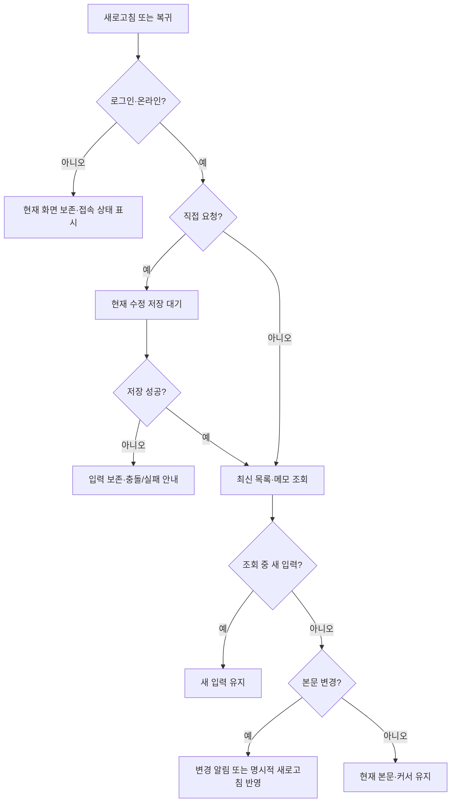

# 편집기와 로딩·동기화·새로고침 보완

- 사용자 승인: 편집기 개선을 진행하고 로딩·동기화·새로고침의 부족한 부분도 정리·구현한 뒤 커밋·푸시·배포한다.
- 기준: `f1d654ddb316482cf3fca5f9d79ddcd5ed91cc2f`, `main`, 시작 `2026-11-16T16:04:08Z`.
- 기존 작업: 체크박스 정렬·Tab/Shift+Tab 수정 3개 파일을 보존·포함한다.
- 배포: main push → GitHub Actions verify → n100 production 웹. stage와 네이티브 앱 스토어 릴리스는 포함하지 않는다.
- 라이브러리 추가·기존 필수 인터페이스 변경·운영 메모의 시험용 수정은 하지 않는다.

## 범위와 소유권

| 담당 | 범위 | 완료 기준 |
|---|---|---|
| editor_interactions | 목록 경계·블록 선택/이동·붙여넣기 선택·모바일 목록 툴바 | 내용·선택·완료 상태·undo 보존, IME·코드·표 예외 |
| document_tools | 문서 찾기/바꾸기·원문 편집 dialog·수정 이력 diff | 명시적 검색, 안전한 치환, raw 원문 emit, 큰 문서에서도 제한된 diff 비용 |
| block_details | 표 병합/분할/헤더·코드 언어/복사·이미지 속성 | 지원하는 저장 형식만 노출, 편집·재조회 일치 |
| root | 저장·보관함·목록 요청·열린 메모 갱신·화면 로딩·통합·배포 | 오래된 응답과 새 입력 분리, 저장 전 갱신 차단, 실패/재시도 표시, 실제 배포 SHA 확인 |

## 확인한 보완 지점

1. 로컬 보관은 저장 요청 직전에 이루어져 debounce 동안 입력이 아직 보관되지 않는다.
2. 이전 저장 성공 응답이 더 새로운 보관 수정을 지울 수 있다. 저장 중 새 입력과 최종 저장 완료를 구분해야 한다.
3. 트리 갱신은 최신 요청만 반영하지만 refresh 실패를 호출부가 직접 판별하지 못하고 공유 진행 상태가 없다.
4. 트리 새로고침은 열린 본문을 갱신하지 않는다. 다른 기기/탭에서 바뀐 본문을 안전하게 감지하는 흐름이 필요하다.
5. 첫 진입 로딩과 문서 간 전환 로딩은 별개다. 이전 본문을 보존하는 동안 잘못 편집하지 않도록 상태를 표시한다.
6. 보관함의 재전송·로그인·화면 복귀·동시 요청·종료 cleanup과 네트워크 timeout을 함께 점검한다.

## 검증·배포

- 기준 단위 테스트 실행 결과와 변경 후 결과를 비교한다.
- 각 담당이 실패 재현 가능한 focused 회귀 검사를 실행한다.
- 최종 통합에서 단위 테스트·typecheck·stage seed test·build·기존 브라우저 회귀 검사를 실행한다.
- 로컬 합성 메모/별도 데이터 폴더/Google Calendar OFF로 문서 전환·저장·새로고침·모바일 UI smoke를 확인한다.
- 최종 diff/개인정보·저장 충돌 경계 검토 후 커밋·main 푸시, Actions 완료·컨테이너 revision·외부 health·배포 asset 확인.

## 저장 형식 경계

일반 문단끼리의 자유로운 계층과 일반 토글 블록은 기존 CommonMark/GFM 저장 모델을 바꾸는 별도 설계다. 이번에는 원문 편집과 이미 지원하는 블록의 조작·저장 일관성을 우선 구현한다. 지원하지 않는 이미지 속성/표 구조는 저장 후 손실되는 UI를 노출하지 않는다.

## 구현 결과

- 목록 Tab/Shift+Tab·빈 항목·혼합 목록 경계를 처리하고 체크박스를 첫 줄 중앙에 맞췄다. 모바일 목록 조작, Esc 블록 선택·선택 확장·복제·이동·삭제·완료 전환, 붙여넣기 방식을 추가했다.
- 문서 찾기/바꾸기, 기기 보관·복구가 가능한 원문 편집, 이력의 줄 단위 변경점, 표 셀 병합·분할·헤더, 코드 언어·복사, 이미지 대체 텍스트·제목 설명·너비를 구현했다.
- 기기 보관을 입력 즉시 수행하고 저장 요청을 직렬화했다. 저장 도중 새 입력과 다른 탭의 보관 수정, 구버전 응답·충돌, 로그아웃·화면 이동을 구분한다. 원문·최초 형식 검사·형식 미승인 수정은 백그라운드 전송하지 않는다.
- 선행 공백을 지워 목록 깊이만 바꾼 수정을 놓치던 비교 로직을 고쳤다. 코드 공백과 강제 줄바꿈도 유지한다.
- 문서 전환 진행 표시·편집 잠금·조회 재시도, 연결 상태·보관 수정 목록, 안전한 수동/자동 갱신과 요청 제한 시간을 추가했다. 구글 캘린더 상태 조회도 중복·늦은 결과를 구분한다.
- Notion 공식 [단축키 문서](https://www.notion.com/help/keyboard-shortcuts)의 Tab/Shift+Tab·Esc 블록 선택·복제·블록 이동을 비교 기준으로 삼았다. 일반 문단 계층/토글까지 동일하다고 주장하지 않는다.
- 기존 의존성·API·저장소 형식을 확장 가능한 범위에서 사용했으며 새 패키지는 추가하지 않았다. 코드·상태 전용 검토에서 발견한 오래된 응답·원문 격리·형식 승인 경계는 수정 후 회귀 검사했다.

## 검증 근거

- `VERIFY_PASS`: 최종 전체 Vitest **66파일/722개**, `pnpm typecheck`, stage seed **7개**, `pnpm build` 통과. 최초 체크아웃의 637개와 비교했으며 통합 중 원격 main의 2개 커밋을 fast-forward로 보존했다. 최종 통과 수에는 그 변경의 검사도 포함한다.
- 실제 Tiptap 브라우저 회귀 **56/56** 통과: 기존 표·컬럼과 목록·체크·블록·붙여넣기·코드/표/IME 예외, undo와 다시 읽기.
- 격리 Nuxt 앱의 합성 메모로 찾기(명시적 실행·2개 치환)→서버 저장, 코드 언어→선택 보존, 이미지 속성→이스케이프·320×240 저장을 확인했다.
- 원문 수정 즉시 보관→브라우저 새로고침→원문 창 복구→직접 저장에서 각주 문자열·이미지 속성의 서버 원문 유지와 보관 수정 제거를 확인했다.
- Tab으로 깊이만 변경→서버 저장→Shift+Tab→저장·새로고침 후 유지. 390×844에서 본문 가로 넘침 없음, 체크박스는 56px 높이 첫 문단의 첫 줄에 맞음(위쪽 6px), 목록 버튼 3개가 화면 안에 보인다.
- 다른 화면의 합성 수정은 자동 조회에서 알림만 띄우고 본문을 유지했다. 수동 새로고침 후 최신 내용·알림 해제·미저장 보관 없음까지 확인했다.
- 표 툴바로 병합→서버 colspan=2 저장→분할→머리글 열 전환→새로고침에서 구조 유지·불필요한 형식 경고 없음 확인.
- 테스트 데이터·dotenv·브라우저는 loopback 격리 환경이고 Google Calendar OFF다. 운영 메모는 시험용으로 수정하지 않았다. 로컬 상세 로그와 합성 산출물은 Git 제외 `_workspace/overhaul-2026-11-17/`에 남겼다.
- 배포는 사용자 승인대로 main push의 production workflow를 사용한다. 실제 최종 SHA·Actions·컨테이너 revision·외부 health/asset 결과는 최종 응답에 기록한다.

## Deferred QA

### editor-sync-reliability-01
- Priority: high
- Preconditions: iPhone 실기기의 현재 WKWebView 앱, 합성 메모와 한글 키보드.
- Actions: 한글 조합 중 목록 편집·터치 들여쓰기·원문 입력·백그라운드 복귀, 실제 클립보드 붙여넣기/복사를 수행한다.
- Expected: 조합·선택·자식·체크 상태가 유지되고 키보드/네이티브 툴바와 충돌하지 않는다.
- Source: 모바일 목록·IME·원문 편집 완료 조건. 브라우저 390px 검증과 실기기 검증은 별개다.
- Status: pending
- Evidence: —

### editor-sync-reliability-02
- Priority: high
- Preconditions: 서로 다른 두 기기의 합성 메모와 네트워크 차단 수단.
- Actions: 오프라인 입력 중 앱 종료·재실행, 다른 기기의 동시 수정, 원문 보관·기기 저장소 사용 불가 상태를 확인한다.
- Expected: 가능한 보관 여부를 정확히 표시하고 기기 보관/충돌이 안내되며, 명시적 승인 없이 서버 최신 내용을 덮지 않는다.
- Source: 저장 경쟁·원문 복구·수동 갱신 계약. 단위 검사와 한 브라우저 새로고침 smoke가 물리적 두 기기 네트워크를 대신하지 않는다.
- Status: pending
- Evidence: —
