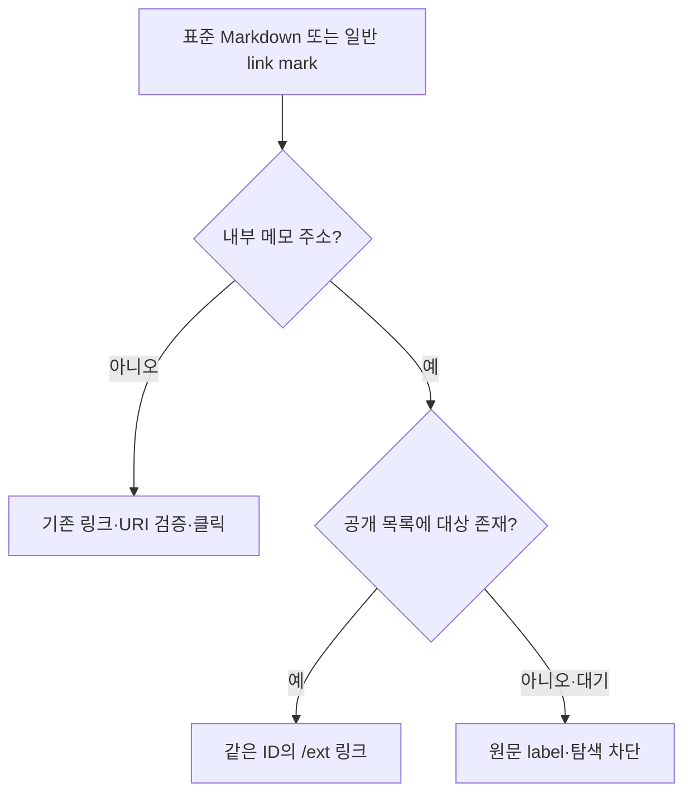

공개 화면의 본문에는 로그인용 메모 주소가 저장될 수 있다. 원문의 표준 Markdown 링크는 유지하되 공개 렌더링에서는 이미 공개된 대상만 공개 주소로 연결한다.

## 원인과 동작

- 이전 MemoReference는 interactive:false이면 항상 span을 그렸고, 일반 link mark의 내부 주소도 public-memo-links에서 모두 제거했다. 공개 탐색 기능이 추가된 뒤에도 이 정책이 남아 문서 연결이 빠진 것처럼 보였다.
- Nuxt UI UEditor의 기본 starterKit.link.openOnClick:false는 편집용이다. ExtMemo의 읽기 전용 화면은 true로 명시하여 일반 텍스트의 링크를 클릭할 수 있게 한다. 기존 Tiptap URI 검증은 유지한다.
- MemoReference.publicHref는 공개 tree에서 확인한 동일 ID의 정확한 /ext 주소만 받는다. 기본 옵션은 비활성 텍스트이므로 다른 사용처의 동작은 유지한다. private interactive 편집 링크와 직렬화는 기존 그대로다.
- ExtMemo는 공개 레이아웃의 ext-navigation 데이터만 공유한다. 비공개 tree나 편집용 API를 추가로 요청하지 않는다. 공개 목록 대기/실패·없는 대상은 비활성이다.
- 참조형 링크·HTML의 일반 link mark는 이미 본문에 있던 ID만 data 속성에 보존한다. 늦게 공개 목록을 받으면 복원하고 공개 해제를 반영하면 비활성화한다. 같은 속성을 다시 쓰지 않아 MutationObserver 반복을 막는다.
- NodeView는 공개 목록 변경을 화면에만 반영하고 저장 원문/자동저장 거래를 만들지 않는다. 공개 화면에서 private 제목·편집용 열기 callback은 호출하지 않는다. 원문 label/title과 외부·mailto 링크는 유지한다.

## 검증 근거

- 기준 main f1d654ddb316482cf3fca5f9d79ddcd5ed91cc2f에서 수정했다. 다른 세션의 폴더 공개·컬럼·공개 검색/트리 변경을 유지한다.
- 수정 전 공개 HTML 참조 회귀1개와 DOM guard 회귀4개 실패를 재현했다. 관련3파일46개, 전체59파일649개 Vitest와 stage seed 독립7개, Nuxt typecheck/build 통과. 로그는 로컬 `_workspace/issues/2026-11-04-public-links/`에 둔다.
- 실제 요청 대상 이력서 원문에는 세 문서의 표준 내부 링크가 이미 있었다. 이력서와 세 대상의 공개 API가 모두200임을 확인하여 원문이나 공개 설정을 덮어쓰지 않았다. 개인 원문·문서 ID는 이 문서에 옮기지 않는다.
- 전용 보안 검토에서 canonical same-ID /ext, private callback 미호출, 공개 데이터만 사용, 기존 URI 검증·원문 왕복·observer 안정성을 확인했다.
- 회사 문서 검사 도구는 실행했으나 기존 저장소에 생성 index가 없고 기존 reference 외부 관련 경로3개 및 README 형식이 달라 실패한다. baseline에도 index는 없으며 README와 관련 경로는 이번 변경에서 수정하지 않았다. 문서 체계를 일괄 이전하지 않았다.
- 서버/API/저장 형식·자격증명·네이티브·stage 설정은 수정하지 않는다. 새 환경변수나 데이터 마이그레이션이 없다. 운영 메모 쓰기 요청은 실행하지 않았다.

## Deferred QA

### public-note-links-01
- Priority: P1
- Preconditions: 개발용 공개 메모, 일반·참조형 링크, Safari/iPhone.
- Actions: 공개 문서의 링크를 클릭·키보드 Enter·새 탭/뒤로가기로 확인한다.
- Expected: 공개 메모는 공개 주소로 이동하고 일반 외부 링크도 정상 동작한다. 편집 화면·컬럼 저장 내용은 바뀌지 않는다.
- Source: 공개 렌더링·nodeview/guard 단위 회귀.
- Status: pending
- Evidence: —

### public-note-links-02
- Priority: P2
- Preconditions: 개발용 공개/비공개 대상과 늦게 완료되는 공개 목록.
- Actions: 목록 로딩 완료와 공개 해제 후 새로고침을 확인한다.
- Expected: 공개 대상만 링크를 얻고 비공개는 탐색하지 않는다. 목록 갱신 전 링크가 남아도 공개 API는 현재 권한으로404를 반환한다.
- Source: 목록 수명·fail-closed·실제 브라우저 미실행.
- Status: pending
- Evidence: —
